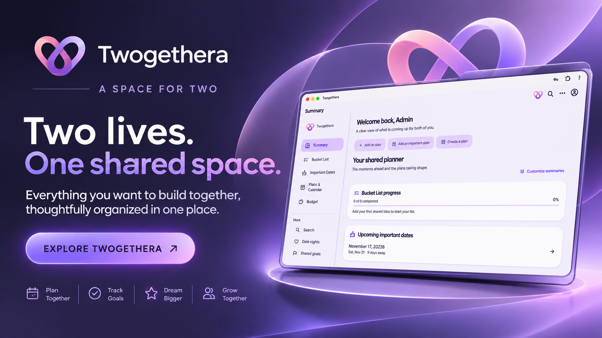
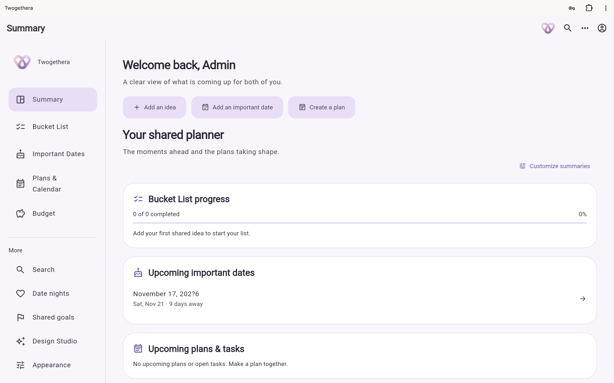
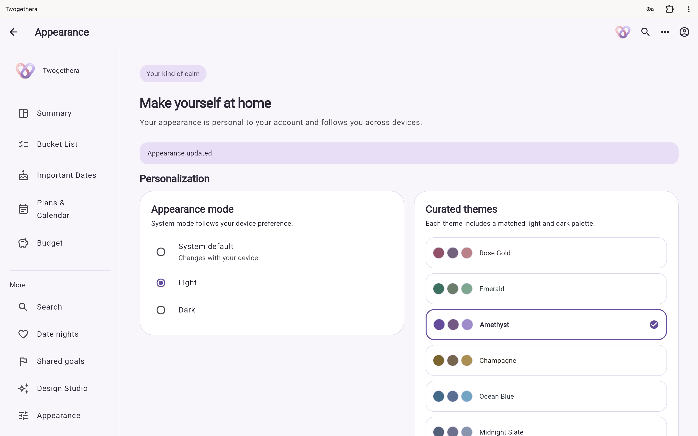
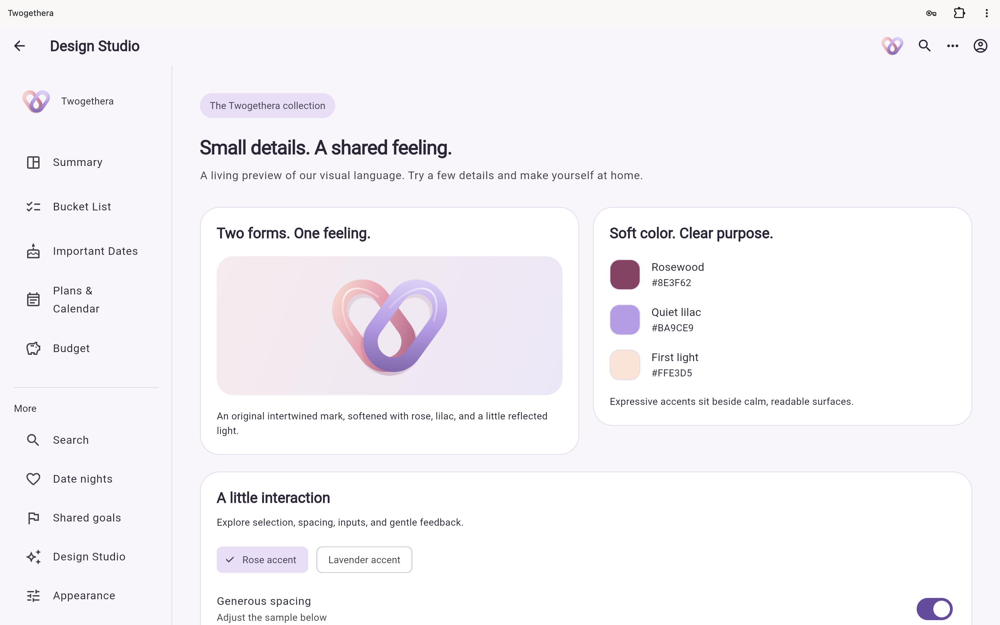
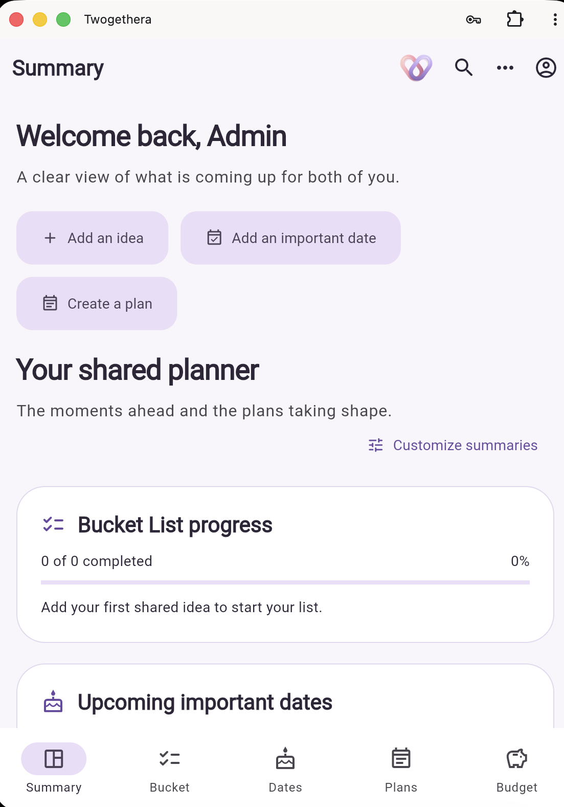

# Twogethera

### A private space for two. A better way to plan life together.

Twogethera is a couples-planning application concept designed to bring shared goals, meaningful dates, everyday plans, and personal organization into one calm, connected experience.

Built with **Flutter and Dart**, Twogethera is designed for Android, iOS, and responsive web—with a focus on thoughtful UI, privacy-conscious architecture, and a consistent cross-platform experience.

<p align="center">
  <a href="https://twogethera.vercel.app/">
    <strong>Explore the Web Preview →</strong>
  </a>
</p>

<p align="center">
  
</p>

<p align="center">
  
  
  
  
</p>

---

## Overview

Planning a life together involves more than keeping a calendar. It means remembering important moments, working toward shared goals, organizing activities, and keeping everyday plans in sync.

Twogethera explores how these experiences can live in one thoughtfully designed digital space.

The project is being developed with a modular Flutter architecture and a visual system that prioritizes clarity, accessibility, responsiveness, and a polished user experience.

> **Project status:** Twogethera is under active development. The public web preview demonstrates the current visual and development milestones. Not every planned planner module or production account feature is available yet.

## Screenshots & Preview

Explore the current interface and visual direction.

| Home / Dashboard | Appearance |
|---|---|
|  |  |
| *Replace with an actual dashboard screenshot.* | *Replace with an actual appearance screenshot.* |

| Studio Preview | Mobile Layout |
|---|---|
|  |  |
| *Replace with an actual Studio screenshot.* | *Replace with an actual mobile screenshot.* |

**Live preview:** https://twogethera.vercel.app/

Screenshots should represent the current public build. Do not use mockups to imply that unfinished features are already functional.

## Product Direction

Twogethera is being designed around these experiences:

- **Bucket List** — A shared place for experiences, activities, and goals to look forward to.
- **Important Dates** — Keep meaningful dates and milestones organized.
- **Savings Tracker** — Plan savings goals and monitor progress together.
- **Plans** — Organize activities, itineraries, tasks, and notes.
- **Global Search** — Find relevant planner content from one place.
- **Memories** — A future space for preserving meaningful moments.
- **Personalization** — Adapt the app's appearance and experience.

Feature availability depends on the current development milestone. Refer to the project status below for the distinction between implemented previews and planned functionality.

## Current Implementation

The repository's documented milestones include:

- Flutter application foundation for Android, iOS, and web.
- Material 3-based interface and reusable UI components.
- Responsive layouts and light, dark, and system appearance options.
- Original visual identity with gradient accents and refined surfaces.
- Home, Studio, and Appearance interface previews.
- Modular feature organization separating data, domain, and presentation layers.
- Routing with `go_router`.
- State and dependency management with `flutter_riverpod`.
- Local development and verification workflows.
- A debug-only, memory-only local authentication proof for development.

### Development and Security Status

The local authentication proof is not production authentication. It does not provide production registration, persistent login, partner linking, or shared planner data.

Do not treat the public visual preview as a production couples account system. Production authentication, authorization, data persistence, and partner collaboration must be verified separately before release.

## Technology Stack

| Technology | Purpose |
|---|---|
| Flutter | Cross-platform application framework |
| Dart | Primary programming language |
| Material 3 | UI components and design foundation |
| Riverpod | State management and dependency injection |
| go_router | Application navigation and routing |
| Flutter Test | Widget and application testing |
| Flutter Lints | Code quality and static analysis |
| Supabase client | Used in the local authentication proof; hosted production services are not implied |

## Getting Started

### Prerequisites

Install the following tools before running the project:

- [Flutter SDK](https://docs.flutter.dev/get-started/install)
- [Dart SDK](https://dart.dev/get-dart) (included with Flutter)
- [Google Chrome](https://www.google.com/chrome/) for web development
- [Android Studio](https://developer.android.com/studio) for Android development
- [Xcode](https://developer.apple.com/xcode/) for iOS development on macOS

The repository was documented with **Flutter 3.47.7 stable and Dart 3.13.5**. Use the matching toolchain when reproducing the verified environment.

### 1. Clone the repository

```bash
git clone https://github.com/oronex-dev/twogethera.git
cd twogethera
```

### 2. Check your Flutter environment

```bash
flutter doctor -v
```

Resolve any required platform dependencies reported by Flutter Doctor.

### 3. Install dependencies

```bash
flutter pub get
```

### 4. Run the web preview

```bash
flutter run -d chrome
```

To start a local web server with a fixed address:

```bash
flutter run -d web-server --web-hostname 127.0.0.1 --web-port 8080
```

Then open:

```text
http://127.0.0.1:8080
```

### 5. Run on a connected device

List available devices:

```bash
flutter devices
```

Run the application:

```bash
flutter run -d <device-id>
```

### 6. Build the application

For a debug Android APK:

```bash
flutter build apk --debug
```

For an iOS Simulator build:

```bash
flutter build ios --simulator --debug
```

Physical iOS deployment requires valid Apple signing configuration, provisioning, and device trust. Release signing and app-store readiness should not be assumed.

## Project Structure

The codebase follows a feature-oriented structure:

```text
lib/
├── main.dart
├── app/
│   ├── bootstrap.dart
│   ├── routing/
│   └── theme/
├── core/
│   ├── config/
│   └── errors/
├── features/
│   ├── authentication/
│   ├── couple_linking/
│   ├── dashboard/
│   ├── bucket_list/
│   ├── important_dates/
│   ├── savings_tracker/
│   ├── plans/
│   ├── global_search/
│   ├── memories/
│   └── settings/
└── shared/
    └── widgets/
```

Each feature is organized around three architectural layers:

- `data/` — Data sources and repository implementations.
- `domain/` — Business rules and application contracts.
- `presentation/` — Screens, components, and user interactions.

Some feature directories are architectural foundations for future implementation; their presence does not mean every module is already functional.

## Quality Checks

Before submitting changes, run:

```bash
flutter pub get
dart format --output=none --set-exit-if-changed lib test
flutter analyze
flutter test
flutter build web
```

Keep tests relevant to the behavior being changed. New features should include appropriate unit, widget, or integration tests.

## Privacy & Architecture

Privacy is a core design consideration for Twogethera.

The architecture is being developed with clear boundaries around account ownership, couple membership, access control, and private planner data.

Future production capabilities may involve secure authentication, server-side authorization, persistent storage, and synchronization. These must be implemented and tested before being described as available product guarantees.

Never commit credentials, private keys, access tokens, personal records, or production secrets to this repository.

## Roadmap

The development roadmap includes:

- [x] Flutter foundation and responsive application structure
- [x] Initial visual system and appearance previews
- [x] Feature-oriented project organization
- [ ] Production-ready authentication and account lifecycle
- [ ] Secure couple invitation and linking flow
- [ ] Persistent shared planner data
- [ ] Bucket List and Important Dates experiences
- [ ] Savings Tracker and Plans workflows
- [ ] Search across supported planner content
- [ ] Production privacy and authorization verification
- [ ] Release preparation for Android and iOS

Roadmap checkboxes should be updated only when the corresponding work is implemented and verified.

## Contributing

Contributions, suggestions, and bug reports are welcome.

1. Fork the repository.
2. Create a focused feature branch.
3. Make your changes while following the existing architecture and coding conventions.
4. Run formatting, analysis, and relevant tests.
5. Submit a pull request with a clear explanation of the change and its verification.

For substantial product, security, or architecture changes, discuss the proposal before implementation.

Please avoid submitting secrets, private user data, or unverified security claims.

## License

No open-source license is currently specified in this repository.

Until a `LICENSE` file is added, do not assume that the code is available for unrestricted reuse, modification, or redistribution.

---

## Acknowledgments

Built with care using Flutter and Dart.

**Twogethera** — A private space for two, designed to make planning life together feel more intentional.
