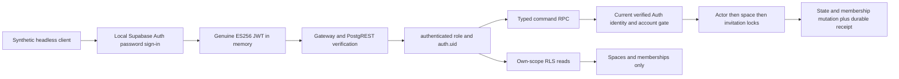

# CP-004B.2 — authenticated membership and invitation command proof

**Implemented and tested locally, 29 October 2026 (Asia/Manila). Not a production database rollout.** CP-004B.1 was reverified at **23/23** scenarios before the requested safe local checkpoint. The CP-004B.2 suite passes **38/38** real Auth/HTTP/database scenarios, with zero mocks/skips. No hosted connection, Flutter integration, product module, Storage, Realtime or pending privacy approval is included.

## Baseline and file boundaries

The entry HEAD was `9bd97e1d54c2c17ba755cd2b6c4ad0ff3a68a5f9`. The only entry changes were seven expected CP-004B.1 files: its report, README, runner, startup helper, isolated config, ignore rules and SQL probe. Their paths/content were reviewed, scanned for secret/token/key patterns and generated artifacts, and the original 23-scenario suite was rerun successfully. Exactly those files were staged and reviewed before committing:

- Commit: `2b5c850028df74671f3b0550b64754f7f382b95a`
- Message: `test: verify real Supabase JWT and HTTP authorization`
- Working tree after that checkpoint: clean; no remotes created and nothing pushed.

CP-004B.2 adds only:

| File | Purpose |
| --- | --- |
| [This report](CP-004B2.md) | Evidence, security boundaries, limitations and next gate |
| [Proof README](../proofs/cp004b2-membership/README.md) | Repeatable setup and exact RPC contract |
| [Runner](../proofs/cp004b2-membership/run_tests.py) | Synthetic real-Auth HTTP, race, rollback and catalog assertions |
| [Startup helper](../proofs/cp004b2-membership/start_local.py) | Separate loopback stack and ignored signing material |
| [Isolated configuration](../proofs/cp004b2-membership/supabase/config.toml) | B.2 project, ports, Auth and disabled unused services |
| [Ignore rules](../proofs/cp004b2-membership/supabase/.gitignore) | Local keys, CLI metadata, logs and environments excluded |
| [Prototype SQL](../proofs/cp004b2-membership/supabase/migrations/20261029000200_commands.sql) | Guarded six-table command experiment, outside root migrations |

All **155 pre-existing source/config/test/documentation files** were checked against an entry SHA-256 snapshot and remain byte-identical, including Flutter UI, tokens, navigation, dependencies, platform files, architecture history and CP-004A/B.1. Existing application checks were not rerun because application files and dependencies are unchanged; no new claim about device rendering is made. All B.2 changes remain untracked/unstaged for review; there is no B.2 automatic commit.

## Local setup and observed environment

From the project root:

```sh
rtk proxy python3 -u proofs/cp004b1-http/run_tests.py
rtk proxy python3 -u proofs/cp004b2-membership/start_local.py
rtk proxy python3 -u proofs/cp004b2-membership/run_tests.py
```

Actual outcomes: B.1 **23/23 passed** before checkpoint; B.2 startup successful; final B.2 run **38/38 passed**, zero mocks/skips. CLI status, Docker engine/context, container project labels and actual published loopback addresses are checked through captured subprocess output without printing credentials. The engine was OrbStack Docker **29.8.2**, Supabase CLI **2.122.0**, PostgreSQL **17.11** (`postgres:17.11.0.006`), GoTrue **v2.197.0**, PostgREST **v16.5**, Kong **2.8.1**. Image tags are observed versions, not an immutable digest lock for production supply-chain verification.

B.2 is a third, distinct local stack `twogethera-b2`: API `http://127.0.0.1:56321`, database loopback port `56322`, shadow port `56320`, local mail capture `56324`. The original `twogethera` and `twogethera-b1` projects/configurations are not reset. Setup/fixture SQL is confined to the verified B.2 container and marked disposable database; every application-schema reset checks the marker. Automatic migrations/seeds are disabled. Do not run root `supabase db reset`, link a hosted project or move this SQL into production migrations.

The startup helper generates a dedicated ignored ES256 signing key using the pinned CLI; the runner configures only B.2 PostgREST to accept this project's public ES256 JWKS, excluding the CLI's legacy shared-development HS256 user-token verifier. Local API/fixture keys and all test passwords/JWTs/raw invitation tokens are captured in memory and suppressed from reports. Signing key file/directory modes are 0600/0700. Never publish raw `supabase status`, debug HTTP traces or CLI startup output.

## Identity and command architecture



Eight unique synthetic accounts use reserved `example.invalid` addresses and generated passwords. All eight are explicitly **admin-confirmed fixtures**, then sign in through the real Auth password grant to obtain actual signed access tokens. B.1 separately proves real signup → local email confirmation → sign-in and natural token expiration; B.2 does not count that flow again. There is no manual JWT signing, SQL client-role impersonation, mocked response or service-role token on a normal RPC/read request. Administrative calls are limited to synthetic Auth setup; local operator SQL installs schemas, inspects state and coordinates race/fault barriers. These privileged probes are not client authorization evidence.

Commands: `ensure_account`, `account_context`, `create_space`, `issue_invitation`, `accept_invitation`, `revoke_invitation`, and experimental `leave_space`. Parameter/result details are in the [proof command contract](../proofs/cp004b2-membership/README.md#command-contract). `can_read` is a current-caller boolean policy helper, not an arbitrary-user membership query. No command accepts a caller-supplied actor UUID. Extra identity parameters are rejected and mutable user metadata cannot grant roles, membership or invitation rights.

Current email is read by one unexposed `SECURITY DEFINER` helper owned by the existing Auth table owner, `supabase_auth_admin`. It accepts only a lock boolean, checks `auth.uid()`/authenticated role, and reads **only that current user's** confirmed, nonanonymous, nonbanned Auth row. The application owner has no Auth SELECT or BYPASSRLS grant. The helper is executable only by the nonlogin application owner, never API roles; schema CREATE is revoked after ownership transfer. This explicit trusted-owner bridge avoids broad Auth-directory reads or a verification flag copied from an old JWT. It remains a privileged bootstrap and hosted-role portability/security review gate before production.

## State, constraints and authorization

Six tables exist:

- `cp004b2.spaces`: UUID, `draft`/`paired`/`closed`, positive epoch and closure timestamp.
- `cp004b2.memberships`: UUID, scope/account FKs, immutable historical seats 1/2, active flag; unique scope/seat and scope/user; partial unique active membership by account.
- Private accounts: Auth UUID FK and enabled gate; ensure/bootstrap never re-enables a disabled row.
- Private invitations: UUID, issuer/scope FKs, unique 32-byte token digest, 32-byte recipient HMAC plus key version, server expiry, pending/accepted/revoked state and accepted actor.
- Private key material: one random 32-byte recipient-binding HMAC key/version for this experiment.
- Private receipts: actor/operation UUID primary key, 32-byte request hash, scope FK and compact result JSON; no raw token or plaintext recipient email.

Deferred triggers require draft=1, paired=2, closed=0 active members at commit. Historical seats cannot be reassigned/deleted/reactivated; closed spaces cannot reopen or change. Draft creation inserts its first seat atomically. Pairing inserts only seat 2 and advances epoch. Partial uniqueness backs one active space per account; seat bounds/uniqueness back maximum capacity. Accepted/failed commands commit or roll back their whole transaction; no partial membership/receipt survives.

All six tables have RLS. Only authenticated SELECT on the two public proof tables is granted, with live private account availability, active membership and open state checks derived from `auth.uid()`. Direct DML is denied. Independent tests temporarily grant DML and prove RLS still blocks insertion and filters update/delete to zero effects, then restore original grants. Private tables/helpers are absent from the API, and private schema profile requests fail. PUBLIC function execution is revoked, every definer uses an empty search path and explicit nonbuilt-in qualification, and the application owner is NOLOGIN/NOSUPERUSER/NOBYPASSRLS with no client role membership. Owner bypass inside the narrow definer perimeter is deliberate; RLS is not claimed to constrain trusted database operators.

Either current member may close the experimental space with the current epoch. Both memberships become inactive and pending invites revoke in one transaction. The same still-valid JWT loses former-scope reads and command/receipt replay immediately after commit. A later draft receives a new UUID; the closed space cannot gain a replacement partner. No existing downloaded bytes are remotely erased. Closed-space reads are denied to both former members **only as this experiment's conservative boundary**, not as final survivor-archive policy. D02's possible survivor archive and all pending privacy decisions remain unchanged.

## Invitation lifecycle and disclosure boundary

Issue requires the verified current issuer's draft membership and expected epoch. A 32-byte CSPRNG produces a one-time 64-hex-character token; only SHA-256 of the token is stored. Expiry is **24 server hours**, checked using `clock_timestamp()` after acquiring locks rather than an old transaction start time. One pending invite per draft; a new operation replaces/revokes the prior pending token. Revocation and acceptance lock the same space/invitation in the same order.

To avoid registration enumeration, issuance returns an identical opaque envelope for every valid unrelated email, including unregistered, unverified or already-occupied accounts. **It is a provisional invitation; issuance is not a statement that an unrelated address is registered or verified.** Acceptance requires the intended **currently verified** email and an available account with no other active space. There is no recipient directory lookup or delivery service. This is the explicit prototype interpretation of “verified recipient” combined with “do not disclose registration”; require product/API review before shipping its wording or delivery UX.

Email binding uses HMAC-SHA-256 under a private key, not a plain dictionary-searchable email digest. Normalization trims outer whitespace and lowercases only the domain; provider aliases, local-part case folding and internationalized email require further review. The token is bound to the exact normalized currently verified mailbox, not mutable metadata or a stale JWT email. Administrative fixture mutations prove unconfirmation/email change blocks a previously signed token's acceptance; a coordinated Auth row-update race proves confirmation loss is rechecked after waiting. Invitation, consumed/revoked/expired/wrong-recipient and unknown-token denials use the same 403 `unavailable` envelope without SQL detail/hints. Timing indistinguishability is not claimed.

## Idempotency and transaction ordering

Each mutating operation among create/issue/accept/revoke requires a UUID scoped to the current actor. A durable receipt stores the command-specific canonical request hash and result in the same transaction. Same actor+ID+payload returns the committed result without reapplying; changed payload or command yields 409. Another actor can independently reuse the UUID. A replay rechecks live authorization to the original scope, so an old receipt cannot restore closed/revoked access.

Issue has an intentional one-time-secret exception: first response includes the raw token; its receipt/retry returns exactly the same invitation UUID/expiry **without** the token. If the first response is lost, the token cannot be recovered; explicitly replace/revoke with a fresh operation ID. No plaintext secret is retained to manufacture byte-identical retries. Accept/revoke/create results are stable. A new acceptance operation for an already-consumed token is denied; the original successful operation may replay while still authorized. `leave_space` uses epoch checking but does not implement a receipt; extending its retry contract is future work.

Lock order: actor's Auth row SHARE → actor's private account UPDATE → space UPDATE → invitation UPDATE. The Auth SHARE lock protects the current verified/email read against concurrent Auth mutation; no Auth trigger writes back into application tables. Actor serialization protects create/accept across multiple target spaces and same-ID retries. Space serialization protects seat capacity, closure, issue/revoke/accept. No client count-then-insert race is trusted. All nine two-request race cases observe both real PostgREST transactions waiting in `pg_stat_activity` before releasing a row barrier; each worker uses an independent HTTP connection. The suite also injects a receipt-write failure after membership mutation and proves full rollback followed by a safe retry with the same ID.

This local lock proof does not certify all GoTrue workflows or hosted permissions. Review Auth lock ordering, transaction timeouts and deadlock recovery under wider workloads before production; do not copy Auth-role ownership transfer automatically.

## Exact CP-004B.2 test results

The following named scenarios all passed in the final runner. Each combines actual HTTP status assertions with identity, returned data and/or database-state assertions as appropriate. Constraint/catalog/fault/barrier SQL is explicitly privileged instrumentation; client success/denial assertions use genuine user tokens.

| # | Passed scenario |
| --- | --- |
| 1 | eight distinct verified synthetic Auth identities; actual ES256 password-grant JWTs |
| 2 | guarded isolated schema; JWT principal resolves through Auth-owner current-user-only bridge |
| 3 | account ensure/context use eight real JWT principals; no caller-supplied member IDs |
| 4 | anonymous space creation denied without side effects |
| 5 | draft creation and durable replay; second active space rejected |
| 6 | 32-byte CSPRNG token; 24-hour expiry; retry returns identical metadata without raw token |
| 7 | operation ID payload/cross-command reuse rejected; null operation IDs rejected |
| 8 | wrong recipient, issuer, malformed and unknown tokens get generic denial |
| 9 | self-invitation, invalid email and stale epoch rejected |
| 10 | verified intended recipient accepts atomically; same operation replays, new operation cannot reuse token |
| 11 | paired member reads and cross-couple RLS isolation; operation IDs scoped per actor |
| 12 | direct space/membership INSERT/PATCH/DELETE denied even to members |
| 13 | paired-space issuance/accepted-invite revocation denied; capacity remains two |
| 14 | either partner closes; same still-valid JWTs and old receipts cannot restore revoked access |
| 15 | new draft uses new space ID; closed history retained without archive reads |
| 16 | revocation and durable revoke replay; foreign revoke and revoked acceptance denied |
| 17 | explicit replacement revokes prior token; server-expired invitation rejected |
| 18 | registered/unregistered/already-occupied recipients share opaque issuance response; capacity checked at acceptance |
| 19 | live Auth confirmation/email checked despite stale genuinely signed email claim |
| 20 | disabled account cannot re-enable via ensure; issuer disable blocks acceptance and RLS reads |
| 21 | concurrent different-operation draft creation: both lock waits observed, one 200/one 409 |
| 22 | concurrent same-operation issue returns one raw token and one metadata replay; one invitation |
| 23 | concurrent different-operation acceptance: exactly one success; two active seats |
| 24 | concurrent same-operation acceptance: two equal 200 receipts; single membership effect |
| 25 | two spaces concurrently invite same recipient: only one active membership can commit |
| 26 | concurrent revoke versus accept serializes to one winner; no partial membership |
| 27 | expiry changed during observed lock wait: both acceptances denied at lock acquisition |
| 28 | caller-supplied identity parameter rejected; real user-metadata edits cannot grant recipient or scope rights |
| 29 | live confirmation removal wins observed Auth-row lock race against acceptance and context |
| 30 | unilateral close versus acceptance: one winner, stale epoch/closed scope rejects loser |
| 31 | injected receipt failure rolls back entire acceptance; same operation succeeds after fault removal |
| 32 | six RLS tables; non-bypass client; no broad Auth reads, private schema access or PUBLIC function execution |
| 33 | private Auth bridge, HMAC key, receipts, invitations and internal helpers not HTTP-exposed |
| 34 | independent RLS write protection survives temporary DML grants: insert 403, update/delete 200 empty |
| 35 | privileged constraint probes: seat bounds/uniqueness, one active space, deferred counts reject invalid commits |
| 36 | closed-space reopening, revoked-seat resurrection and replacement partner blocked by triggers |
| 37 | database stores SHA-256 token digests and keyed recipient HMAC; no raw tokens/emails in invitation/receipt rows |
| 38 | database/PostgREST/gateway/Auth log scan: no tested raw invitation tokens, passwords or user JWTs |

Expected HTTP distinctions are verified: unauthenticated access is 401/403; invalid email/self-invite/input is 400; conflicting operation ID/second active space is 409; sensitive denials are generic 403; foreign reads and RLS-filtered update/delete are 200 with `[]`; private schema profile is 406 and unexposed helpers/tables are 404. Database state assertions ensure denied operations do not create seats, change counts or leave a partial pair.

## Logging and validation

Before any invitation request, the runner sets statement logging off, error statement logging to panic, and parameter logging lengths to zero **only in the guarded disposable B.2 database**, then restarts only B.2 PostgREST so its pool inherits those defaults. No invitation token is placed in a URL. The suite scans database, PostgREST, gateway and Auth container logs in memory for all test raw invitation tokens, current user JWTs, generated passwords and the fixture service key. It also checks invitation/receipt row projections contain no raw tokens or plaintext recipient emails. These scans passed. Raw logs, secrets and database dumps are never saved to reports.

This experiment disables potentially sensitive statement diagnostics; production needs structured, redacted audit/security telemetry rather than blind logging suppression. The scans cover the exercised containers/values and error paths, not every possible future log sink, rotated log, token or stack trace. CLI local keys/metadata remain ignored and are not staged. Source checks cover Python parsing, TOML parsing, Markdown links/fences, whitespace, diff scope and credential/generated-artifact patterns. A scan is a safeguard, not a guarantee that every possible secret format is detected.

## Limitations and unresolved gates

1. **Prototype only:** destructive proof-schema resets and trusted local operator access are not deployable migrations. Fresh application-schema installs are tested; no N-1 upgrade/staging migration rehearsal or production rollback plan is claimed. No hosted service/credential is used.
2. **Auth ownership boundary:** the narrowly constrained Auth-owner helper is a privileged experiment. Hosted role capabilities, ownership transfer, managed Auth update compatibility, mailbox uniqueness/normalization and all lock schedules need review. This does not authorize changing managed Auth tables/triggers or granting the application broad Auth reads.
3. **Tokens/sessions:** B.2's actual Auth JWT TTL is 600 seconds; B.1 verifies natural expiration. B.2 does not test refresh/recovery/OAuth or every issuer/audience/algorithm rejection. Unlink/account-gate denial is live; existing downloaded data and outstanding valid identity tokens are not remotely erased. RLS reads use live account/membership/state, not a per-read Auth-session/ban lookup; Auth ban/signout alone is not an immediate read-revocation guarantee.
4. **Invite lifecycle:** no email sending, callback UI, delivery retries, recovery or abuse protections. Issuance is provisional and non-enumerating; verification/capacity gates are at acceptance. One-time response loss requires explicit replacement. Equal generic errors do not establish constant response timing. Production endpoint rate limits and token-redacted telemetry are required.
5. **Key/receipt custody:** private HMAC material is in the trusted local database; administrator/backup compromise is outside the tested boundary. Production key custody/rotation, operation receipt quotas/TTL, invitation cleanup and normalized request version upgrades are unresolved. No indefinite retention policy is approved by retaining local test rows. Synthetic Auth accounts accumulate between runs; cleanup must stay scoped to this disposable project.
6. **Privacy:** [DECISION_SPECIFICATION.md](architecture/DECISION_SPECIFICATION.md) remains authoritative. D01/D02 approvals and D03's revision are preserved. P03 shared archives, P04 privacy removal/recovery and P09 auditable financial retention remain unresolved; no survivor archive, account deletion, retention period, shared-text recovery, Storage/Realtime, export or financial policy is implemented. Closed-space denial here does not determine final survivor ownership/removal rights.
7. **Concurrency scope:** nine real lock-coordinated race cases and one injected acceptance rollback pass. This is bounded integration evidence, not exhaustive concurrency/model checking, load testing or formal verification. Future production code still needs timeout/deadlock/retry and longer-running Auth workflows tested.

## Recommended next milestone and stop gate

Recommend **CP-004B.3 — migration portability and security hardening rehearsal**, subject to explicit authorization. Review the current-user Auth bridge and command contract first, including provisional issuance and token-loss behavior; then write reviewed additive migration slices in a separately authorized local-only development/staging setup, not by copying this prototype SQL wholesale. Test fresh bootstrap and N-1 upgrade/failure recovery, owner/grant boundaries, wider Auth-change lock interactions, role portability, rate limits, receipt lifecycle and redacted audit telemetry. Repeat both real-JWT negative authorization and lock-coordinated race suites on the isolated staging target.

Keep Flutter, production credentials, deployment, archives, deletion/retention, financial expiration, Storage and Realtime outside that next scope until their separate gates are approved. CP-004B.2 stops here for review. No B.2 commit or push is made.
