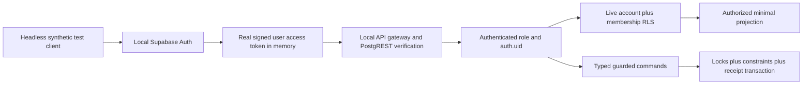

# CP-004B preparation — real local identity and authorization boundary

**Status: proposed implementation scope, not implementation authorization.** Prepared 29 October 2026 (Asia/Manila). This task reverified CP-004A, prepared this plan and authorized a local Git checkpoint. It does not implement production authentication, add migrations/dependencies, connect hosted Supabase, change Flutter UI or approve product decisions. [DECISION_SPECIFICATION.md](architecture/DECISION_SPECIFICATION.md) remains the authority for recorded decision status.

## Checkpoint evidence and meaning

The documented command was rerun successfully against the existing local OrbStack/Supabase stack:

```sh
rtk proxy python3 -u proofs/cp004a-security/run_tests.py
```

**Actual result: 28/28 scenarios passed; zero skipped.** PostgreSQL 17.11, Supabase CLI 2.122.0, OrbStack Docker server 29.8.2. Thirteen ordinary scenarios plus five independent-connection concurrency scenarios repeated across three fresh-fixture rounds. The runner observed database lock waits before releasing each barrier. The isolated database was `twogethera_cp004a_proof`; the application's Supabase database was not reset/migrated.

| CP-004A component | Actual execution boundary | What it does not prove |
| --- | --- | --- |
| Member reads, isolation, commands, anonymous denials, stale operations and replay | Genuine connections as `cp004a_test_*` or `cp004a_anon`, without owner/superuser/BYPASSRLS privileges | Real Auth identity, JWT signature/issuer/audience/expiry or HTTP gateway behavior |
| Verified identity and spoof test | Private synthetic identity mapping from `session_user`; harness-controlled verified flag; forged writable claim ignored | Supabase-issued tokens, Auth email-confirmation/change, real `auth.uid()` contexts |
| Concurrent invite/operation/record/revocation scenarios | Restricted callers plus privileged observer/blocker coordinating real database locks | HTTP-level concurrency, every schedule, load or all isolation levels |
| Capacity/count/historical-seat direct constraint probes | Some assertions intentionally use privileged fixture SQL to bypass commands and exercise database constraints | RLS cannot be inferred from these privileged assertions alone |
| Catalog, fixtures, expiry changes and reset | Local `supabase_admin` setup/inspection | Production administrator/operator isolation |
| SECURITY DEFINER helpers | Dedicated owner bypass inside explicit guarded code; clients cannot assume owner | Automatic safety of future definer functions or production grants |

All identity-bearing business cases depend on synthetic identities, including all race scenarios. Setting a fake `request.jwt.claim.sub` is a useful spoof-rejection check but is not a JWT-validation test. The baseline runner uses Python assertions under ordinary nonoptimized Python; future CI must explicitly reject optimized assertion-disabled execution. Token/logging controls are local experiment safeguards, not production observability approval.

CP-004A is a reference suite and isolated design experiment. Do not copy its session-role mapping, passwordless fixture roles, trust-loopback access, single generic command dispatcher, schema reset SQL or broad table-owner privileges into production migrations. Closed-space denial to both members is an experimental boundary, not approval to erase survivor records or a final archive policy.

## Smallest recommended milestone

**CP-004B.1: local Supabase Auth → signed access token → PostgREST → `auth.uid()` → scoped RLS read.** Use synthetic accounts and a test-only authorization probe. No Flutter client, login screen, persistent client session, product table or invitation workflow is needed for the first slice. This establishes the missing trust boundary before transplanting membership operations.

Later CP-004B slices progressively add the reviewed membership and invite kernel. Passing B.1 does not authorize implementing every later slice. Stop and report at each agreed gate; unresolved policy values never become defaults because the prototype used them.

## Architecture and dependencies

- Keep the approved Flutter/Riverpod/go_router application and dependencies unchanged. A headless integration harness exercises local HTTP endpoints independently of the UI; do not introduce empty future Flutter repository classes.
- Use a separately configured **local Supabase test project** with unique project ID, ports and volumes. It needs real local Auth, PostgREST and PostgreSQL; do not reuse/reset the current developer stack or the CP-004A database without an explicit disposable-target guard. Local email capture only, no external SMTP/SMS/OAuth provider credentials or real addresses.
- Use the existing CLI/container engine and pin tested CLI/database/Auth/PostgREST image versions in the later implementation manifest. Inspect ports/network and restrict access to the local machine. Loopback URLs alone do not establish that Docker published ports are private.
- Prefer a Python standard-library HTTP/process harness initially; add an HTTP/database driver only when justified by async or deterministic connection needs and review/pin it then. No SDK/package is added in this planning task. Optional pgTAP is complementary to actual HTTP tests.
- Auth alone owns passwords, refresh/session material and `auth.users`. Application identity is the UUID primary key; do not mirror credentials or expose private Auth rows. Use a minimal private account registry (`user_id`, active/disabled gate) for current authorization; this is not account deletion/recovery implementation.
- Proposed schemas: exposed `api` for narrow safe reads and typed RPCs; unexposed `private` for account registry, identity checks, memberships/locks as needed, invitations and compact receipts. Final table placement/grants require migration review. An exposed-schema entry is not a grant and RLS is not a replacement for column/table/function privileges.
- Membership kernel: couple spaces, membership seats, authorization epoch, irreversible first closure, private invitation state and idempotency receipts only. No production shared product modules. A synthetic probe belongs in test fixtures only, never a shipped product migration or public test endpoint.

Proposed data flow:



The [Supabase JWT guide](https://supabase.com/docs/guides/auth/jwts) and [RLS guide](https://supabase.com/docs/guides/database/postgres/row-level-security) describe the token/context boundary. The acceptance criterion is signed-token behavior through the local API, not merely setting SQL claims or decoding an unsigned payload.

## Proposed implementation slices

| Slice | Minimal deliverable | Gate before proceeding |
| --- | --- | --- |
| B.0 — isolated test project | Pinned local config, disposable-target guard, explicit schemas/default privileges, secret-safe harness, clean migration replay | No hosted/nonlocal URL; no reset of current stack; exact role/image/version evidence |
| B.1 — real identity bridge | Local synthetic Auth accounts, real sign-in and issued JWTs, safe identity read/probe, `auth.uid()` principal | Positive user identity and invalid-token/anonymous negative HTTP tests pass; no service key on assertions |
| B.2 — account/space kernel | Minimal private account registry and explicit account-context routine, spaces/memberships, create and unilateral unlink | One active space/account, max two members, no replacement/reopen; old JWT loses former-scope access after committed unlink |
| B.3 — invitation transactions | Separate issue/revoke/accept RPCs, verified identity binding, expiring digest tokens, per-actor receipts | Identity/expiry/revoke races, one-use/retry and capacity invariants pass through real authenticated HTTP contexts |
| B.4 — migration and staging rehearsal | Fresh bootstrap plus previous-version upgrade tests, independent local staging stack, documented failure recovery and evidence | Full negative matrix, schema/grant catalog checks and all races pass; approved formal gates documented |

B.1 may use an isolated read fixture/temporary probe policy before the membership tables exist, explicitly labelled test-only. B.2/B.3 then replace the fixture with real membership predicates. Do not invent permanent user-owned shared data to make onboarding more useful; D09's exact state/write behavior remains pending formal approval. No shared-data archives, retention schedules or final Auth-user deletion is implemented.

## Identity and session security boundaries

1. Synthetic accounts use generated test-only passwords and reserved `.invalid` addresses. Produce tokens from the running local Auth service, never sign fake tokens with an admin key and call that equivalent to sign-in. A privileged local fixture may create/confirm synthetic users; add at least one end-to-end email-confirmation flow using local mail capture to test the real transition. Record which accounts were admin-confirmed fixtures versus confirmation-flow accounts.
2. Local fixture/admin secrets, passwords, access/refresh tokens and invite links stay in process memory or a narrowly permissioned ignored temporary channel; no committed dumps, HTTP traces, screenshots, argv, raw errors or readable artifacts. Refuse nonlocal endpoint/redirect/SMTP targets before any account mutation. Reject remote Docker overrides and verify intended container labels/ports.
3. HTTP negative assertions use only public local API identification plus actual user Bearer access tokens. No service/admin key on RLS requests; isolate admin fixture code from user requests and assert request-header roles in the harness without logging values. A publishable/anon API key is not a signed-in user identity.
4. Database functions derive actor from `auth.uid()`; no principal parameter, role from mutable metadata, session_user account mapping or client-provided membership claim. `auth.uid() IS NULL` denies; a Supabase anonymous-sign-in user is distinct from the unauthenticated `anon` role and must be explicitly rejected if anonymous sign-in is unsupported.
5. Verified-email and account availability must be checked against trusted current Auth/account data inside narrow unexposed helpers. Do not trust an old token's email or user-editable `raw_user_meta_data` as fresh proof of verification/membership. Explicitly test email-change/verification races and decide a lock/revalidation protocol before invite migration. Avoid introducing row locks on Auth tables that conflict with Auth service order without a concurrency review.
6. Prefer one explicit online `ensure_account()` bootstrap command that validates current Auth identity and idempotently inserts a minimal private account registry over an unreviewed automatic Auth trigger. This is a proposed technical choice, not a decision about account deletion. Never reactivate an existing disabled account by login/bootstrap. If choosing a trigger instead, test signup failure/rollback and make that choice explicit: a failed trigger can affect signups. [Auth data integration guidance](https://supabase.com/docs/guides/auth/managing-user-data).
7. A valid JWT establishes identity, not current couple rights. Every read/command checks live account/membership/state. An unexpired old JWT must fail former-scope access after unlink. Sign-out token revocation is a separate session concern; do not claim every outstanding token disappears immediately.
8. No Flutter session persistence or provider wiring in this milestone. Initial browser sensitive persistence remains disallowed under endorsed D08; a future SDK's default local token persistence must not silently override it. Native key/storage feasibility remains separate work before sensitive native persistence.

## Membership, commands and RLS

Use database constraints as backstops: partial unique active membership by user UUID, at most two immutable historical seats per space, same-space composite FKs, state/revision checks and commit-time count invariants. No count-then-insert without locks; no generic client membership INSERT/UPDATE/DELETE.

Review lock order explicitly for account, scope/space and invitation/entity rows, including two recipients accepting into different spaces and unlink versus acceptance. Acquire sorted account/scope locks consistently, re-read after waits and retry bounded deadlock/serialization failures with the same operation ID. Revalidate identity/verified-email binding at the defined acceptance boundary. Do not carry CP-004A's simpler lock scheme into multiple-actor production routines without review.

Expose narrow versioned operations (`ensure_account`, `account_context`, `create_space`, `issue_invitation`, `revoke_invitation`, `accept_invitation`, `unlink`) with bounded typed inputs, derived actor, expected epoch/revisions where needed and allowlisted output columns. Revoke PUBLIC/anon EXECUTE and direct DML by default. Avoid a generic arbitrary table/command/JSON mass-assignment endpoint.

The helper that breaks membership-policy recursion must be narrowly owned and unexposed, with fixed empty search_path and fully qualified objects. Use a dedicated NOLOGIN least-privilege function owner rather than broad admin ownership; document any intentional table-owner RLS bypass and validate actual grants. Invoker reads and safe-column projections must not inherit a definer view's access accidentally. Every exposed object and function receives catalog tests, not just a sample table.

Unlink updates membership/space/epoch atomically without waiting for partner consent or export completion. Deny former-scope reads immediately on future requests. For this limited milestone, closed shared-content access is unavailable and unavailable archive APIs fail closed; do not delete retained records or implement retention/ownership rules to work around unresolved decisions. A safe own-account context may report linkage loss without revealing former shared details. No guarantee of remotely erasing copies already delivered.

## Invitation hardening and idempotency

- Proposed binding follows technically endorsed D06: recipient verified-email identity, cryptographically random one-use token, server-time expiry, manual sharing and explicit revoke/regenerate. Exact production duration, canonicalization/key/rate-limit choices require formal signoff; prototype 24-hour behavior is not approval.
- Store a token digest and versioned recipient-email HMAC in private schema, with server-side key access. No raw token/email in shared feeds, lookup APIs or logs. Pin a non-lossy normalization compatible with actual Auth identities; no dot/plus alias equivalence. Define key rotation/expiry/revocation behavior and fail closed when a verification key is unavailable. Cryptographic/key-management design is a B.3 gate, not a secret requested here.
- Atomic acceptance consumes the pending invite, verifies the intended current identity, enforces both users/space states and capacity, inserts membership, advances epoch and records outcome in the same transaction. Wrong account, unverified, expired, revoked, consumed or unknown token returns a safe generic result.
- Rate limiting and response privacy need local abuse tests. No automatic email sender, account-existence search or external provider integration. A raw token is shown once to its issuer; loss requires revoke/regenerate rather than server recovery.
- Actor-scoped operation UUID plus versioned canonical request hash yields deterministic replay. Payload collision rejects. Successful effects and receipt commit together; failed transactions have neither. Check current authorization before any replay result; unlink receipts can return only a separately authorized own-exit status, never former data. Define bounded receipt lifetime with the affected future lifecycle; no infinite personal-body retention or premature expiry that allows duplicate effects.

## Test strategy and negative authorization matrix

Retain CP-004A unchanged as regression/reference. Add two complementary suites later: database/catalog/independent-lock tests for invariants and **real signed-JWT HTTP tests** for gateway, Auth, Data API and RLS. SQL claims fixtures may supplement tests but do not replace HTTP token validation.

| Test family | Required evidence |
| --- | --- |
| Genuine identity | Auth sign-in JWT reaches intended `auth.uid()`; same authenticated DB role yields different user principals and isolated results |
| Token validation | Missing/malformed/tampered/expired token, wrong issuer/audience/signature or disallowed algorithm fails closed; exercise actual local verifier, do not turn off verification to make tests pass |
| Anonymous distinction | API key without user JWT denied; unverified and unsupported anonymous-sign-in accounts rejected |
| Principal spoof | Changing actor/scope fields or mutable user metadata cannot impersonate or grant access; SQL-only fake claims are not treated as HTTP evidence |
| Scope isolation | Two couples plus unpaired and revoked users; own authorized projection succeeds and every other-scope read/aggregate/RPC/error path leaks no content |
| Direct writes | INSERT/UPDATE/DELETE/TRUNCATE, protected column updates, identity/member/epoch substitution and parent-scope mismatch denied |
| Capacity and state | Simultaneous create/accept/third-member attempts enforce one active space and two seats at commit; no replacement/reopen after closure |
| Invitations | Wrong/unverified/changed email, expiry while waiting on lock, revoke-versus-accept, double redemption, unknown/consumed tokens and cross-space replay |
| Idempotency | Same/different operation IDs, changed payload, concurrent retry, lost response and rollback yield one effect or deterministic denial |
| Revocation | Reuse the same actual issued JWT and HTTP client after unlink; former reads, writes, context/receipt and invite operations fail without waiting for token expiry |
| Functions/grants | Actual `anon`/`authenticated` grants, RLS on every exposed relation, invoker views, definer owner/search_path, no unintended PUBLIC EXECUTE or direct private access |
| Migration/fixture failure | Clean install, N-1 upgrade, existing-account bootstrap, failed signup/bootstrap and interrupted command/migration leave no partially granted insecure state |
| Leakage | Secret scanner plus sanitized assertion/error/log output; no raw tokens, passwords, invite payloads or partner-private Auth data in artifacts |

Each negative test asserts HTTP outcome **and** persisted row counts/revisions, distinguishing forbidden/empty-filtered reads from a failing request that accidentally wrote data. Verify authenticated role ownership/BYPASS flags and prevent privileged fixture headers from contaminating user clients. Assert tests are not disabled by optimized Python or skips. Reuse real lock observation/barriers for deterministic overlap; add bounded stress repetitions without claiming every schedule is proven. Reset/cleanup only the test-owned database/project under exact sentinel/endpoint guards; do not delete a developer's existing Auth users.

For forged JWT cases, mutate existing test tokens in memory; issuer/audience/algorithm cases that need signed fixtures require a specifically local-only test issuer/key with an explicit verifier setup. Such fixtures test rejection and must not weaken local Auth verification or be committed as usable signing keys. If a particular verifier behavior cannot be exercised, mark it blocked rather than counting a simulated SQL test as passed.

## Safe migration sequence and risks

No migrations are created by this preparation. After separate approval, write reviewed, additive, ordered SQL in the designated new local development project; never put `proofs/cp004a-security/schema.sql` into the production migration runner. Use [Supabase migration guidance](https://supabase.com/docs/guides/local-development/database-migrations) with an explicit local-only target guard.

1. Baseline: record local schema/catalog versions and grants; assert a dedicated disposable target and secret-free configuration. Diff every generated file against intended changes, excluding Auth/Storage-managed schema churn.
2. Security boundary first: private/API schemas, owners, revoked default privileges and RLS before client grants; new objects unavailable until policies/functions are installed. Test actual local Supabase role privileges—do not assume local postgres is a superuser or every hosted environment allows identical role creation.
3. Minimal identity/account bootstrap and own-context read; reference Auth primary UUID, avoid credential mirror and blind ON DELETE CASCADE into shared rows. No Auth-user erasure routine.
4. Membership tables/indexes/checks and narrow helpers; unique/count constraints plus immutable closure. Future nonempty-data changes require a preflight duplicate/count report before validating constraints; fail rather than deleting conflicting rows.
5. Typed commands, private invite/receipt design, grants and API schema-cache/exposure checks. Grant only completed tested surfaces. Do not expose private schema to solve RPC discovery.
6. Clean-install and upgrade rehearsal followed by complete HTTP/database test suites. Measure locks/timeouts. Review irreversible changes explicitly; transactionally roll back supported failures and document a forward fix/recovery for others. Never promise all DDL has a safe down migration.

Main risks: initial default API exposure/grants, Auth data/trigger failures, RLS recursion/definer bypass, JWT/principal mismatch, unique-index build failure, lock-order deadlock and deployment role/version differences. Keep test probe tables/roles/fixtures outside shipped migrations. No root stack `db reset`, destructive `db diff` output or hosted `db push` as an implementation shortcut.

## Local-only development and isolated staging

For CP-004B, staging means a **second disposable local Supabase stack**, not a hosted project. Assign a separate project ID, all service ports and volumes, synthetic Auth users, mail capture and fresh local secrets. Rehearse the same reviewed migrations first on development and then on that local staging stack; verify a failed test cannot touch the other stack. Stop/reset only the explicitly owned disposable stack. Do not create it during this planning task.

Record API/DB endpoints, Docker context/project labels, migration head and expected database marker before every destructive command. Pin versions and reject inherited remote Docker/DSN/CLI targets. Configured loopback client URLs do not prove bind-address isolation: inspect published ports and firewall/network behavior. The checked-in current `supabase/config.toml` is a local scaffold, **not a hardened production template**: confirmation is disabled, minimum password length is 6, public schemas are exposed, TLS is off locally, services such as Storage/Realtime are enabled by default, and automatic exposure/default grants require review. No live policy or config was changed here.

No hosted staging account, secrets, remote linkage, OAuth/SMTP setup, paid service or deployment is authorized. A later real staging/production environment requires separate approval, secret management, configuration/security review and privacy signoff. Local green tests alone do not authorize launch.

## Unresolved approvals and excluded scope

D01/D02 remain approved to their recorded boundaries. D03 revision remains recorded; P03 archive ownership/eligibility/duration, P04 text recovery and P09 audit necessity/horizon remain unresolved. Other endorsed technical directions still require formal approval of unresolved details. Explicitly authorize the selected B slices and their exact draft/paired state machine, verified-email/invite parameters, key/rate/receipt rules and user-facing disclosures before their implementation.

Never implement shared-data archive retention, final account deletion/recovery, financial audit expiration, shared-text recovery, production Storage or Realtime policies in CP-004B. Also exclude Flutter UI changes, production Auth screens/providers, product modules, persistent client sessions, offline/cloud sync and automatic deployment/commit/push. Closed-data access stays unavailable without resolving archive product rights; this is not perpetual retention permission.

## Definition of done for a separately approved CP-004B

- Real local Auth-issued JWTs flow through the API to correct `auth.uid()` and current scope checks; no synthetic session-user mapping in the production-oriented kernel.
- RLS denies cross-couple/anonymous/revoked access under actual `authenticated` and `anon` contexts; negative tests cannot silently use privileged keys.
- Reviewed additive migrations create only authorized minimal identity/membership/invite/receipt surfaces, with explicit grants and no shipped test probe.
- Membership, invitation, replay and revocation invariants pass through both database/concurrency and real-token HTTP tests with repeatable versioned commands and actual counts; unsupported tests fail/mark blocked, never pass by simulation.
- Clean install and previous-version upgrade succeed on distinct disposable local development/staging stacks; failures have documented recovery and do not affect the current developer stack.
- Token/credential/log safety, fixed definer perimeter, default privilege and catalog checks pass; temporary test accounts/resources are scoped and inventoried.
- Pending privacy decisions remain unchanged; no excluded lifecycle/Storage/Realtime feature or Flutter/UI/dependency change slips into the milestone.
- Reports distinguish verified results, incomplete coverage, pending policy gates and production/deployment prerequisites. Stop for review; no hosted connection or deployment.

## Current checkpoint review

All uncommitted source/documentation/config paths were inspected against the previous UI commit. Expected scope: architecture resolution/history, CP-004A proof/report, existing secret-free local Supabase scaffold, root README decision notes and this new plan. The scoped scan found no private-key/JWT/provider-token/credential-URI matches or unexpected sensitive/generated candidate paths. Environment substitutions and commented placeholder paths in config are not live credentials.

Supabase `.temp/` and `.branches/`, Python caches, database/build artifacts and environment/signing files are excluded by existing ignores. Only `supabase/config.toml` and its `.gitignore` are eligible from the local scaffold. A scan is not a guarantee of detecting every possible secret format; staged paths/content must be reviewed again before the authorized commit. UI/design/platform/test/dependency files are byte-identical to entry and unchanged from the approved visual commit. No previous commit is amended; no remote is created or pushed.

The requested local checkpoint message is `test: establish Twogethera security proof and architecture review`. Its actual hash/status are reported after committing; this plan does not embed a self-referential future hash. Planning ends here without starting B.0/B.1.
