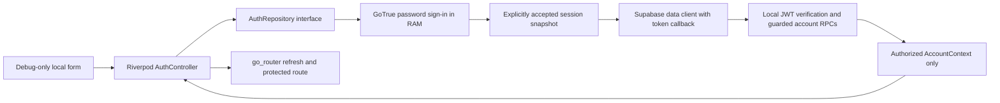

# CP-005A — local Flutter authentication foundation

Local synthetic-data integration, 30 October 2026 (Asia/Manila). No production/hosted authentication, persistence, account recovery, partner linking or shared feature data is enabled. Architecture approval statuses and the approved visual system remain unchanged.

## Checkpoint and preserved baseline

The eleven expected B.4 files were reviewed for credentials, private keys, generated databases/logs and unrelated changes. Scoped scans and staged diff/whitespace checks passed. B.4's **57 counted cases passed** before checkpoint; its full Auth signer-rollover limitation remains unverified, not counted as a pass.

- Commit: `9a6287f0ef8bd229d7347910ff6e05e5edf11b81`.
- Message: `test: validate local authentication security and operational boundaries`.
- Working tree was clean before CP-005A implementation. No previous commit amended, remote created or push performed.

The original Home, Studio, Appearance, adaptive shell, design components, themes/tokens, animations and their existing tests are preserved. Existing architecture/B-series files remain byte-identical. Public preview routes are still previews, not privileged shared-data routes. No earlier placeholder login screen existed; the new development flow is separate rather than a replacement of approved screens.

## Architecture and contracts



The only application dependency added is **supabase 2.16.5**, pinned exactly; the SDK's pinned GoTrue version is **2.27.3**. `integration_test` from the installed Flutter SDK is a development dependency for native runtime testing. Existing locked package versions are not upgraded. No `supabase_flutter`, SharedPreferences, secure-storage plugin, database or persistence dependency is installed.

Implemented components:

- `LocalAuthConfig`: explicit opt-in, development/debug-only, exact loopback/emulator host and port allowlist, public anon-key role validation; rejects hosted URLs, credentials in URLs, query/fragments, wrong ports and admin-key formats. Unknown `APP_ENV` fails closed rather than throwing at bootstrap.
- `LocalAuthClients`: injected factory creates separate standard GoTrue and Supabase data clients. The data client's explicit token callback avoids on-demand refresh; it never calls `auth.getSession()` to refresh implicitly.
- `MemoryAuthStorage`: per-instance Map-backed SDK PKCE storage. It has no browser/file/plugin backend. Password-login session objects reside in SDK/application RAM; they are not serialized into this map.
- `SupabaseAuthRepository`: synthetic-email-only password sign-in, account bootstrap/context RPCs, safe failure mapping, observed session/expiry events, explicit local memory clearing, generation guards and disposal. No raw SDK errors or Session objects reach the UI state.
- `AuthController`: Riverpod loading/signed-out/authenticated/error states, dependency-injected repository and stale-response cancellation. Authenticated means a current context request succeeded, not merely that a JWT was decoded.
- Routes `/auth/local` and `/account`: registered only under `kDebugMode`. Protected account access requires authorized context; loading/expired/error states fail closed without redirect cycles. Existing navigation remains intact.

`ensure_account` and `account_context` use the B.4 proof's `cp004b2` API schema, derive the actor on the server, and never accept a user ID from Flutter. The returned projection is own user UUID plus authorized space/state/epoch metadata. The screen displays only a verification status/count, not emails, tokens or shared records. No space is created automatically. Missing membership does not grant planner access, and 403 is not converted to an unpaired success.

The client exposes no registration, refresh, server logout, recovery, OAuth, linking or product-write method. The standard SDK contains other APIs, but they are not connected through the application contract. Administrative keys and the maintenance role are never supplied to Flutter.

## Session lifecycle and memory limits

1. Cold start has no accepted session and performs no backend call or recovery from storage/URL. The client bundle is created lazily after explicit sign-in.
2. Password sign-in accepts the returned session into a private in-memory snapshot. Context lookup must then succeed before protected routing opens.
3. Automatic refresh is disabled. Source inspection showed that `SupabaseClient.getSession()` can refresh **on demand** even with its timer disabled, so data requests use a separate client with an explicit valid-token callback instead.
4. A deadline is armed directly from the accepted session's expiry. The client refuses requests at its own expiry check, drops authorized context, and requires another explicit sign-in. A delayed timer cannot bypass the per-request expiry guard.
5. Unauthorized server context removes the protected projection. Membership/account revocation is enforced by the server on subsequent requests; no Realtime/push watcher is enabled. An already displayed snapshot is not a promise of continuously live authorization.
6. “Clear local proof session” discards this client's state/resources and invalidates pending responses. It is **not server logout**, refresh-token revocation or global JWT erasure. No deferred logout feature is silently enabled.

The pinned SDK broadcasts Session messages over same-origin `BroadcastChannel`. This is transient memory transfer, not localStorage persistence. The adapter ignores peer/broadcast events and pins protected requests to the session accepted from its own explicit sign-in; a real peer-client test proves it does not switch identity or extend its accepted expiry. It does not claim secrecy from same-origin scripts, prevention of the SDK's broadcasts, secure RAM zeroization or confidentiality from DevTools/OS memory/swap. Future SDK/persistence work must review this behavior again.

A fresh adapter cannot restore the prior login. Browser tests compare localStorage, sessionStorage, cookies and IndexedDB database inventory before/after the real flow without printing values. This is not an exhaustive browser HTTP-cache/OS forensic audit. SDK verbose logging must remain disabled: its internal Session `toString()`/finest diagnostics can contain credentials. Global app errors are now generic and do not log raw exceptions/stacks; Auth errors are mapped to fixed user-facing messages. Password fields disable autofill participation/personalized learning and cancel autofill context; external keyboard/browser behavior cannot be universally controlled.

## Local endpoints and transport

| Runtime | Default endpoint | Evidence/limit |
| --- | --- | --- |
| Flutter Web on Mac | `http://127.0.0.1:58321` | Real Chrome runtime tests against B.4 |
| iOS Simulator | `http://127.0.0.1:58321` | Simulator build passed; runtime result recorded below |
| Android Emulator | `http://10.0.2.2:58321` | Mapping unit-tested; debug APK build passed; emulator runtime not claimed |
| Physical devices | Unsupported in this proof | localhost refers to the device; no LAN/hosted endpoint is accepted |

The normal debug config omits the URL so platform mapping applies automatically. An explicit `LOCAL_SUPABASE_URL` is allowed only for the exact supported local hosts on port 58321. HTTPS/hosted deployment is not configured. Do not use local HTTP/synthetic test credentials on untrusted networks or treat it as a production transport design.

Android's new cleartext allowance is under **src/debug only**, limited to emulator/loopback hosts with a deny-by-default base policy. Main/release manifest and release network security are unchanged. iOS Info.plist/ATS settings are unchanged; simulator build success alone does not prove runtime HTTP behavior or physical-device support. Any future ATS exception must be debug-scoped and validated; do not weaken release ATS for this experiment. No native persistence is introduced.

## Run the interactive proof

Keep the existing local B.4 stack/schema installed; this phase does not reset it or introduce migrations.

```sh
rtk proxy python3 tool/prepare_local_auth.py
rtk proxy flutter run -d chrome --web-port 8082 --dart-define-from-file=.local/cp005a/app-defines.json
```

Open `http://localhost:8082/#/auth/local`. The helper writes only public configuration to ignored owner-only `app-defines.json`; synthetic email/password are separately in ignored owner-only `.local/cp005a/preview-credentials.json`. Read that local file to use the form; no credentials are printed in the report/UI or hardcoded in source. The form accepts only `@example.invalid` fixtures. Native debug launch can use the same public defines and `--route=/auth/local` on a supported simulator/emulator. Restart/reload requires explicit sign-in again.

Without `LOCAL_AUTH_ENABLED=true`, valid local public configuration and a debug development build, the form cannot sign in. In release builds the proof routes/controls are absent entirely. The release web bundle was checked for absence of the sign-in form label. Approved previews remain available.

## Real tests and fixture isolation

The test orchestrator checks B.4 container/marker/loopback state and creates unique synthetic verified fixtures through local Auth administration, then Flutter signs in normally. No service key is compiled into Flutter. A loopback-only, random-nonce test broker can suspend/restore **one fixed fixture UUID** via the already approved maintenance function; it cannot accept arbitrary UUIDs, SQL or script commands. It is alive only during tests and never part of the app/backend deployment.

Fixture defines are ignored, mode 0600 under a 0700 directory, and removed after testing. Compiled test artifacts can contain synthetic fixture passwords; they are ignored artifacts, not app configuration or source. Fixture passwords are retired and the B.4 fixture gate disabled on a best-effort cleanup path; no account deletion is implemented. A separately prepared preview fixture remains usable for review. Do not publish test artifacts or enable verbose SDK logs.

The Chrome entry is generated temporarily under `test/` because Flutter's web test compiler needs that root; the reviewed template/support cases are versioned, and the generated ignored entry is removed afterward. Do not run the ordinary unit suite concurrently with that generated entry. Native tests use the Flutter SDK integration-test binding.

Counted real cases (no mocks):

1. UI sign-in failure and success, protected routing/context identity, actual suspension/restore, fresh adapter denial, local clear and browser persistence snapshot.
2. Real unreachable endpoint returns a sanitized unavailable failure.
3. Genuine B.1 Auth-issued 60-second token expires without refresh. A peer client's sign-in cannot replace the accepted session; the adapter denies after expiry; an explicit original-token PostgREST probe also eventually rejects it. No JWT/clock is forged. B.1 is used only for its existing short-lived Auth setup; B.4's 600-second configuration is unchanged.

The pinned server verifier permits clock tolerance, so the real expiry case polls for rejection after the client's deadline rather than assuming identical timing. Client expiry is fail-closed before server tolerance ends. This is not instantaneous global JWT invalidation.

## Verification evidence

```sh
rtk proxy dart format --output=none --set-exit-if-changed lib test test_local integration_test
rtk proxy flutter analyze
rtk proxy flutter test
rtk proxy python3 -u tool/run_local_auth_tests.py chrome
rtk proxy flutter build web
rtk proxy flutter build apk --debug
rtk proxy flutter build ios --simulator --debug --no-codesign
```

- B.4 checkpoint regression: **57/57 counted cases passed**, full signer-rollover limitation preserved.
- Unit/widget suite: **45/45 passed** (27 existing + 18 new). Repository fakes in these isolated tests are **not** backend-security evidence. New tests cover config/DI/storage/controller states, failures, stale results, routing/expiry, responsive dark layouts and light/dark accessibility.
- Real Chrome suite: **3/3 passed** using actual local Auth/JWT/PostgREST and the Flutter UI.
- Release web build: passed, including Wasm dry-run; a nonfatal Cupertino font-family warning was reported. Current app uses the existing Material icon set; no unrelated font dependency was added.
- Android debug APK: passed. JDK native-access warnings were nonfatal. No Android runtime test or physical device is claimed.
- iOS unsigned simulator build: passed. Native authentication runtime is **unverified**: the initial simulator UUID became unavailable; after booting an available iPhone 17 simulator, the runner failed its local-backend preflight (first stack-status failure, then a subprocess timeout). No native authentication case was executed or counted as passed. The simulator started for this attempt was shut down afterward. Retry command: `rtk proxy python3 -u tool/run_local_auth_tests.py <available-simulator-UUID>` with a booted simulator and responsive B.4/B.1 stacks.

Intermediate failures were corrected rather than counted: web test entry-root resolution, test semantics-handle disposal, a local OrbStack outage (restored), and expiry scheduling susceptible to peer SDK events. The final explicit-session snapshot/peer filter and real expiry probe address the application issue. No test replaces a real backend denial with a mock or suppresses a failure as a pass.

## Files and remaining gates

Application additions are under `lib/features/authentication/` and `lib/core/config/local_auth_config.dart`. Modified integration points: router, bootstrap/global error handler, safe AppConfig environment parsing, pubspec/lock, debug Android manifest, ignores and README status. New tests/tooling: `test/authentication_test.dart`, `test/support/`, `test_local/browser_entry.dart`, `integration_test/local_auth_test.dart`, and the two local preparation/test scripts. The only new native policy file is the debug-scoped Android network XML. No approved visual file or architecture approval record is edited.

### Exact source inventory

- `.gitignore`
- `README.md`
- `android/app/src/debug/AndroidManifest.xml`
- `android/app/src/debug/res/xml/local_auth_network_security.xml`
- `docs/CP-005A.md`
- `integration_test/local_auth_test.dart`
- `lib/app/bootstrap.dart`
- `lib/app/routing/app_router.dart`
- `lib/core/config/app_config.dart`
- `lib/core/config/local_auth_config.dart`
- `lib/core/errors/app_error_handler.dart`
- `lib/features/authentication/application/auth_controller.dart`
- `lib/features/authentication/data/local_auth_clients.dart`
- `lib/features/authentication/data/supabase_auth_repository.dart`
- `lib/features/authentication/domain/auth_repository.dart`
- `lib/features/authentication/presentation/local_auth_screen.dart`
- `pubspec.lock`
- `pubspec.yaml`
- `test/authentication_test.dart`
- `test/support/browser_storage.dart`
- `test/support/browser_storage_stub.dart`
- `test/support/browser_storage_web.dart`
- `test/support/real_auth_cases.dart`
- `test_local/browser_entry.dart`
- `tool/prepare_local_auth.py`
- `tool/run_local_auth_tests.py`

All 26 paths are unstaged. Local fixtures and generated builds remain ignored. Credential-pattern scanning found no embedded JWT, private key, credential URI or secret-key pattern in these source paths. This is a scoped review, not a guarantee against every possible secret format.

CP-005B prerequisites: dedicated real refresh/logout/recovery and callback/deep-link tests before exposing those flows; memory-only browser lifecycle/no-autologin checks across process/tab boundaries; protected native credential persistence feasibility before retaining sessions; public SDK update/source review; operational backend portability and full signer/privileged-key rotation; production TLS/host/gateway controls. The B.4 Auth-owner helper remains a production review gate. No production readiness is claimed.

Do not enable registration/recovery/OAuth UI, persistent login, background refresh, partner linking, shared synchronization, native database/media persistence, account deletion/archive retention or pending privacy policies in this phase. Stop for CP-005A review. No CP-005A commit or push is authorized or performed.
