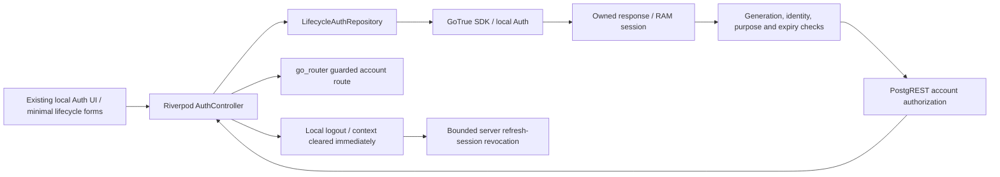

# CP-005B.2 — local authentication session lifecycle

Local synthetic-data milestone, 31 October 2026 (Asia/Manila). This extends the opt-in development authentication adapter, not production authentication. No hosted backend, migration, architecture approval, persistence, OAuth, partner-linking or unrelated visual change is included.

**Current review status:** CP-005B.2 is **locally complete for review** after the Android recovery continuation below: Android passed all twelve real lifecycle cases and the native retained-data restart/storage proof. The earlier failures remain documented as history. This is not production approval or approval of pending architecture decisions.

## Checkpoint and scope

The four pending CP-005B.1 files were reviewed for secrets, generated outputs and unrelated changes. The original unit/widget suite passed **45/45**, and the original Chrome integration suite passed **4/4**, before staging only those four paths. The authorized checkpoint is:

`0ed70631f1c1227fc840704d8da719cfdb3e8f91`

`test: verify cross-platform authentication runtime and session isolation`

The working tree was clean after that commit. CP-005B.2 changes remain uncommitted. Nothing was pushed and no remote was created. Historical reports and architecture decision statuses are preserved.

## Lifecycle architecture



`LifecycleAuthRepository` extends the existing repository contract. The adapter accepts authority only from its own operation response after checking the operation generation and client identity. SDK events, including same-origin peer broadcasts, cannot replace the accepted session. The data client obtains tokens exclusively from that accepted RAM snapshot; it does not use SupabaseClient's implicit refresh path. Auto-refresh is explicitly disabled on both the owned GoTrue client and the otherwise-unused internal Auth client constructed by the data SDK. SDK inspection found that a custom token callback alone does not prevent that internal client from existing. Its default timer could consume a browser-broadcast token and cause independent rotation; the expiry test now requires successful HTTP refresh responses and rejects a masked `400` fallback.

The controller clears account context while loading/refreshing, represents expiry, suspension and network failure distinctly, and permits account routing only with a fresh authorized account context. Operation generations and a busy-operation lease prevent late responses/finalizers from overwriting newer state. Recovery verification has its own state without account context. Cancelling recovery signs out and returns to login without a redirect loop.

## Controlled refresh

- Refresh is explicit through the supported `GoTrueClient.refreshSession(acceptedRefreshToken)` operation. Concurrent callers share one in-flight future and one HTTP request.
- A successful response must identify the same account, pass expiry checks and replace the accepted credential atomically. The controller then fetches account authorization again; refreshing an Auth token does not bypass account suspension.
- Access expiry immediately denies data access and removes visible account context. The refresh credential remains in RAM solely for explicit refresh/sign-out; restarting still requires sign-in.
- Network/timeout/server failures are distinguished from rejected credentials. An uncertain refresh response could have rotated a credential, so this implementation discards the local session and asks for fresh sign-in rather than adding adapter retries with a possibly consumed token. The SDK has its own transport-retry behavior; the adapter's eight-second wait does not cancel an HTTP request already in progress. Disposed/generation-invalid responses cannot restore local authority, but server completion can remain uncertain.
- Logout detaches authority before awaiting network work. A delayed genuine refresh/sign-in response cannot restore local authentication afterward. A request already accepted by the server cannot be undone by a Dart future timeout; no rollback guarantee is claimed.

## Logout semantics

Ordinary sign-out immediately clears the accepted session, protected account context, timers and active operation authority, and returns to login. It uses Auth's supported `/logout` operation with **local scope**, the owning user's access JWT and the public API key. The SDK method lives under `auth.admin.signOut`; no privileged key is supplied to the application. Explicitly passing the owned JWT avoids accidentally signing out a peer SDK client's session. Other devices' refresh sessions survive ordinary sign-out.

An expired access credential requires a bounded genuine refresh before the server can accept its revocation. Offline/failed server logout still clears local authority, but displays that server revocation could not be confirmed. It never claims that issued credentials were erased remotely. Already issued access JWTs can remain cryptographically and API-valid until expiry. Suspension/membership authorization checks are separate server controls.

## Confirmation and password recovery

Registration is limited to synthetic `@example.invalid` addresses and the existing local-only configuration gate. With local email confirmation enabled, registration must return no session. A configuration that unexpectedly signs the registrant in fails closed. Minimal forms reuse existing components, themes, spacing and responsive patterns.

The local Mailpit development mailbox captures real Auth messages. For this milestone a user pastes the captured verification URL into a masked form. The adapter validates local host/port, `/auth/v1/verify`, purpose and bounded input; it extracts the token/hash in RAM and uses SDK `verifyOTP`. It does not navigate to the bearer URL, put it into go_router state, log it, or add automatic OS/browser deep-link handling. Existing routes remain intact. Real signup verification yields an owned session followed by server account authorization. Invalid, expired and replayed confirmation links fail closed.

Recovery uses SDK `resetPasswordForEmail`; eligible and unknown addresses receive the same public-facing success wording. Genuine recovery verification is accepted only for password update/cancel, with account-data retrieval denied by the adapter. This is a client-purpose restriction, **not a claim that Supabase issues a server-restricted recovery JWT**. Production APIs need an independently reviewed server enforcement model if they must deny direct API access by recovery credentials.

Password update uses supported SDK `setInitialSession` and `updateUser`. Because the pinned SDK reads its mutable `currentSession`, the adapter seeds its own recovery snapshot and invokes update synchronously before yielding; the returned user must match. This protects against peer broadcasts selecting another actor. This ordering depends on the pinned SDK and is covered by a real cross-actor regression test; SDK upgrades require review. After successful update, global Auth logout revokes refresh sessions and the user must sign in with the new password. Other issued JWTs can still last until expiry. If update/revocation times out, the password may already have changed: server completion is uncertain, so the UI must not claim complete global revocation.

Passwords, links and session credentials are RAM-only. Form controllers clear secret input before awaiting operations and are disposed. No persistent session plugin, credential store or browser storage backend is added. This does not promise zeroization of Dart strings/SDK internals or prevention of screenshots, clipboard capture, compromised same-origin code, OS diagnostics or forensic recovery.

## Real test method

The guarded runner verifies the isolated B.4 local backend and synthetic-only fixture scope before creating accounts. Auth, signed JWTs and PostgREST/RLS are genuine; privileged fixture setup stays on the host and is not evidence of client authorization. Flutter receives public API identification and temporary synthetic credentials via owner-only ignored test definitions, removed afterward.

The lifecycle suite uses genuine HTTP responses. A transport seam can hold an already completed response to reproduce a logout race, or direct a request to unused loopback port 1 to produce a real network failure. It never fabricates a successful Auth response. A host-only nonce broker retrieves fixed synthetic recipients' messages from Mailpit without following links. Expiry tests require a newly issued, unconsumed token and age only that fixture's issuance timestamp by two hours; Auth itself rejects the genuine token. No JWT forging, server clock change, migration or weakening of expiry is involved. The short-lived B.1 stack supplies genuine 60-second JWTs for real access-expiry checks.

The 12 real lifecycle scenarios cover:

1. Rotation, single-flight refresh, owning-session logout, survival of another device session, old-JWT behavior and cross-actor broadcast isolation.
2. Refresh followed by real suspension denial, protected routing and restored authorization.
3. Genuine network interruption versus rejected refresh credentials.
4. Offline logout and honestly unconfirmed server revocation.
5. Delayed genuine refresh response after logout, including server refresh rejection.
6. Delayed genuine sign-in response after local logout; no local resurrection.
7. Registration, unconfirmed sign-in denial, captured confirmation, replay rejection and account context.
8. Genuine expired confirmation and invalid link rejection.
9. Generic recovery, captured link, recovery data denial, pinned password update, global refresh revocation and old/new-password reauthentication.
10. Newly issued expired recovery and invalid recovery rejection.
11. A stale failed sign-in cannot clear a newer authenticated session.
12. Real access expiry, explicit refresh after expiry and logout after subsequent access expiry.

Most real lifecycle cases call the repository directly; the suspension/routing case mounts the real Riverpod/go_router UI. They do not claim complete tap-through coverage of every new form, OS deep links or physical devices. Unit/widget tests use fakes and are reported separately. They exercise controller transitions, async races, redirect behavior and new form layouts at mobile/tablet/desktop widths with 200% text scaling; they are not backend evidence.

## Native retry evidence

The first iOS attempt built successfully in 108.9 seconds and passed the first two lifecycle cases, including a full exact rotated-token scan of 11 private files/cache. During subsequent cases, both Mac Auth health endpoints timed out at eight seconds and `docker info` timed out at twelve seconds while OrbStack reported Running. Swap use was approximately 7.8 GiB on this 8 GiB host. The validation Flutter child was interrupted and only the validation simulator was shut down. The engine and both Auth health endpoints then recovered without an engine restart. The resource-pressure correlation is recorded; an OOM or exact underlying VM fault is not established. Subsequent inspection reported `OOMKilled=false` for the B.4/B.1 Auth, database, gateway and REST containers; the B.4 restart counters were zero. That attempt is a failed/incomplete native run, not a pass. The subsequent retry passed all twelve cases without increasing application timeouts or weakening assertions (Xcode build 180.6 seconds; cases and teardown 2m33s). Its automatic retained-container process-death/relaunch proof also passed, with exact-token scans of 11 live, 12 post-termination and 12 post-relaunch files.

The first Android attempt built its APK (172.6 seconds) and installed successfully (214.0 seconds), but the Flutter test launch never became available; after interruption it reported **No tests ran**. ADB remained boot-complete, the guest had 8.8 GiB disk free and about 2.7 GiB available RAM, and the sampled crash buffer contained no entries. These observations do not establish a crash or an authentication-code failure. The runner cleaned its mappings/fixtures before normal emulator shutdown. The original AVD configuration hash remained unchanged. A subsequent cold boot uses the same read-only software-rendered AVD and two cores with the supported runtime-only `-memory 2048` override, to reduce host paging; this is a mitigation under test, not an established root cause. No data wipe, snapshot replacement, transport-security relaxation or timeout increase is involved.

The 2 GiB software-rendered retry built again (150.6 seconds), but Flutter reported an `am force-stop` timeout and did not reach a test. A later bounded `am get-current-user` query did return primary user 0, so activity-service responsiveness was intermittent, not proven permanently unavailable. It was stopped normally after fixture/mapping cleanup. The final bounded trial uses runtime-only host graphics and 3072 MiB RAM on the same read-only AVD. These are environment trials, not application or saved AVD configuration changes. The helper now checks activity-service readiness before fixture setup/build work.

Negative revocation assertions were strengthened during review to require an Auth API HTTP 400/401 error; network exceptions/5xx cannot satisfy them. Previously completed runs used the unchanged application code but the earlier assertion helper. Final verification below distinguishes the stricter reruns. A native `--functional-only` option explicitly skips the separate process-restart proof for test-harness-only reruns; it is not a replacement for the already executed proof against the same application source, and reports its omission.

The final Android trial compiled the strengthened assertion markers, built in 155.3 seconds and installed in 35.0 seconds. An explicit supported `am start -W` returned `Status: timeout`; the integration target eventually launched, but **0/12 cases passed** because local Auth was unavailable. At that point OrbStack explicitly reported **Stopped**, the Docker socket was absent, and host Auth connections were refused. Earlier preflight had succeeded. The reason OrbStack stopped is not established; it is not attributed to authentication code or claimed to be an OOM. No Android restart/storage proof executed. The validation emulator was shut down normally and the original AVD configuration hash still matched. Android runtime verification is blocked, and an APK build does not substitute for it. Normal non-destructive OrbStack startup succeeded; both B.4 and B.1 Auth health endpoints returned 200 afterward. No reset/prune/volume deletion was used. Because outage-time fixture retirement could not complete, a guarded host-only follow-up identified only the six synthetic addresses embedded in this run's compiled test target, then confirmed random-password rotation for its three existing fixture accounts. No identities or credentials were printed; no account was deleted.

## Initial CP-005B.2 commands and execution results

These are the initial execution results, before the Android recovery continuation. The recovery results below supersede the Android blocker and record the new regression checks; prior successful Chrome/iOS runs are not represented as freshly rerun.

| Check | Result |
| --- | --- |
| `rtk proxy flutter analyze` | Passed; no issues |
| `rtk proxy flutter test` | **62/62 passed** on final source (45 original + 17 lifecycle unit/widget cases) |
| Chrome original real/HTTP suite | **4/4 passed** after changes: real Auth/UI, unreachable backend, controlled HTTP responsiveness and genuine expired JWT rejection |
| Chrome lifecycle suite | **12/12 passed** on final stricter assertions; revocation rejections HTTP 400, short-lived refresh HTTP 200/200, logout 204 |
| iOS lifecycle + retained-data restart/storage proof | **12/12 passed again** with final stricter assertions and three fresh 11-file live scans (2m37s including teardown). Separate earlier retained-container restart proof passed scans of 11/12/12 files against unchanged application source; explicitly not repeated by functional-only rerun |
| Android lifecycle + retained-data restart/storage proof | **Not verified**: two no-test launches, final 0/12 failed with OrbStack stopped; no restart/storage pass |
| `rtk proxy flutter build web --no-pub` | **Passed**, exit 0; 61.71 seconds |
| `rtk proxy flutter build apk --debug --no-pub` | **Passed**, exit 0; 22.26 seconds |
| `rtk proxy flutter build ios --simulator --no-codesign --no-pub` | **Passed**, exit 0; 45.22 seconds |
| Format / diff whitespace | Passed; 26 Dart files already formatted, `git diff --check` clean |
| Source/document/secret review | 15 intended paths; protected architecture/design/platform hashes unchanged; no staged paths; scoped literal-secret scan, Python syntax, Markdown fences and local links passed |

Canonical real-test commands:

```sh
rtk proxy python3 tool/run_local_auth_tests.py chrome
rtk proxy python3 tool/run_local_auth_tests.py chrome --lifecycle
rtk proxy python3 tool/run_local_auth_tests.py 165E464B-E43E-4A0E-9C77-876677198367 --lifecycle
rtk proxy python3 tool/run_local_auth_tests.py emulator-5554 --lifecycle --adb-reverse
```

The final test-harness-only iOS recheck used:

```sh
rtk proxy python3 tool/run_local_auth_tests.py 165E464B-E43E-4A0E-9C77-876677198367 --lifecycle --functional-only
```

Use a currently available simulator UUID. Native lifecycle runs additionally execute the existing process termination/relaunch proof: same retained data witness/container, old JWT still accepted by the real server, cold app signed out and protected context denied. Exact live access/refresh tokens are searched in all private app files/cache while live, after termination and after relaunch. Keychain/Keystore/OS forensics are outside that filesystem audit; no credential persistence backend is installed. Live native audits also search exact newly rotated, confirmation and recovery credentials in private files/cache during their respective flows. Chrome checks browser storage surfaces. These are scoped observations, not universal forensic-erasure guarantees.

Android uses test-owned ADB loopback forwarding because direct emulator host-alias connectivity failed in CP-005B.1. The existing `Medium_Phone_API_37.0` AVD booted successfully for this phase with a read-only overlay, no snapshot load/save, software graphics and two cores; its persisted data/configuration were not wiped or replaced. The helper removes only mappings it created. No AVD wipe, hosted service, production ATS/network-security change or privileged app key is required.

Web build emitted the nonfatal Cupertino font-family warning already documented in [CP-005A](CP-005A.md). No font configuration or approved visuals were changed. Gradle emitted its Java native-access warning; all three normal builds exited 0.

At end of verification, the validation iOS simulator and Android emulator were shut down, both local Auth health endpoints returned HTTP 200, temporary fixture definitions/generated browser entries were absent, and only this phase's three private Android startup logs were removed. The original AVD configuration hash still matched. Git contains 10 modified and 5 new intended paths, with nothing staged; HEAD remains the checkpoint above. No remote or push was added.

## Changed files and remaining risks

Changed paths:

- `.gitignore`
- `lib/app/routing/app_router.dart`
- `lib/features/authentication/domain/auth_repository.dart`
- `lib/features/authentication/data/local_auth_clients.dart`
- `lib/features/authentication/data/supabase_auth_repository.dart`
- `lib/features/authentication/application/auth_controller.dart`
- `lib/features/authentication/presentation/local_auth_screen.dart`
- `pubspec.yaml` and `pubspec.lock`
- `tool/run_local_auth_tests.py`
- `test/auth_lifecycle_test.dart`
- `test/support/lifecycle_real_cases.dart`
- `test_local/lifecycle_browser_entry.dart`
- `integration_test/lifecycle_test.dart`
- `docs/CP-005B2.md`

The explicit test-only `http` dependency was already present transitively; no package was upgraded. Dashboard, branding, design tokens, platform configuration, backend schemas and architecture history are untouched.

Remaining production work includes hosted configuration review, trusted redirect/deep-link registration, anti-enumeration/rate-limit/abuse controls, delivery reliability, MFA/recent-auth policy, recovery-token server scope, SDK upgrade review, safe observability, device/session management and explicit revocation policy for stateless JWTs. RAM-only sessions deliberately require sign-in after restart. Temporary test bundles contain synthetic passwords and must never be distributed as release artifacts. Development mailbox access is local infrastructure, not production email security.

## Initial readiness before Android recovery

The implementation and completed Chrome/iOS evidence are ready for review, but **CP-005B.2 is not fully signed off while Android runtime and its native restart/storage proof remain unverified**. The immediate follow-up is to diagnose why OrbStack stopped during native work, establish reliable simultaneous backend/emulator operation, then rerun the unchanged Android lifecycle and retained-data restart/storage checks. Three environment trials did not produce a pass; no APK build is presented as a substitute.

CP-005C implementation should wait for review and resolution of that validation gap. Its subsequent scope should first specify production recovery/deep-link and server authorization boundaries and review uncertain refresh/logout/password-update outcomes, before implementing an explicitly approved slice. Persistent login, hosted deployment and pending privacy decisions remain outside this milestone. No CP-005C work, automatic CP-005B.2 commit or push was performed.

## Android recovery and final verification — 31 October 2026

This continuation preserves the initial results and failed-attempt history above. The recovery-entry Git inventory matched exactly the fifteen intended paths. Hashes of all 207 tracked/pending source and documentation files were captured before work. No source, shared test, dependency, platform configuration or architecture-policy change is authorized or required for this recovery; only this report is being updated.

### Diagnosis and evidence

- OrbStack was already **Running**. The selected Docker context was `orbstack`, Docker resolved to `~/.orbstack/bin/docker`, and no `DOCKER_HOST`, `DOCKER_CONTEXT` or `DOCKER_CONFIG` override was set. Engine info returned in 0.29 seconds, reporting Docker 29.8.2, eight CPUs and a 4,179,832,832-byte VM memory limit. No engine restart was performed.
- Both local Supabase status commands exited 0 with the expected loopback APIs: B.4 at `127.0.0.1:58321`, B.1 at `127.0.0.1:55321`. Status JSON and credentials were captured, never printed. Both Auth health endpoints returned HTTP 200 in about 0.02 seconds at entry.
- B.4/B.1 database, Auth, REST and gateway containers were running; all inspected `OOMKilled` flags were false. B.4 restart counters were zero. B.1 Auth retained its existing restart count of one; this is not evidence of a new crash. Bounded recent logs showed expected negative-test Auth codes such as `otp_expired`, `invalid_credentials`, `email_not_confirmed` and `refresh_token_not_found`, with no panic or out-of-memory markers in the inspected sample.
- The Mac has 8 GiB RAM and eight CPUs. Entry swap use was approximately 6.9 GiB, available disk space 15 GiB, and load averages 5.05/13.96/14.18. These justify limiting simultaneous workloads; they do **not** prove why OrbStack stopped previously. Two older OrbStack Helper diagnostics dated 29 October described disk-write activity with `Action taken: none`; they do not establish the cause of the 31 October outage. No matching current OrbStack/QEMU crash report was found in the inspected diagnostic-report directories.
- Diagnostic subprocesses used explicit limits: eight to twelve seconds for ordinary engine/log/ADB probes, twenty seconds for Supabase status, and bounded socket requests. No reset, prune, image/volume deletion, database reset or unrelated-container stop was used.

### Recovery execution

The existing `Medium_Phone_API_37.0` ARM64 AVD was reused with a read-only overlay. Only process arguments changed:

```sh
rtk proxy /Users/fielmark.oronos/Library/Android/sdk/emulator/emulator \
  -avd Medium_Phone_API_37.0 -port 5554 -no-window -no-audio \
  -no-snapshot-load -no-snapshot-save -read-only -gpu host \
  -cores 2 -memory 2048 -no-boot-anim
```

ADB reported a connected emulator, boot completion `1` and primary activity user `0`. A temporary, test-owned `tcp:58321` reverse mapping proved **guest HTTP/1.1 200 OK** from local Auth. The initial netcat probes that closed their request stream returned no response; retaining the stream until response headers arrived succeeded. This was a probe-lifecycle issue, not evidence that the application's network path was broken. The diagnostic mapping was removed before the test runner created its own B.4, B.1 and nonce-broker mappings. Direct `10.0.2.2` connectivity was not revalidated or substituted for the proven tunnel.

The actual unchanged suite command is:

```sh
rtk proxy python3 tool/run_local_auth_tests.py emulator-5554 --lifecycle --adb-reverse
```

It runs in a child environment with these additional, process-only Gradle options:

```text
GRADLE_OPTS += -Dorg.gradle.jvmargs=-Xmx1536m -Dorg.gradle.workers.max=2 -Dorg.gradle.daemon=false
```

No saved Gradle/AVD settings, test assertions, application timeouts or security configuration were changed. The limited heap was observed in the active Gradle JVM arguments. The APK built in 99.8 seconds and installed in 23.7 seconds. The existing helper still creates synthetic accounts through guarded local host setup, signs in through the real SDK, exercises real Auth/PostgREST, and automatically invokes the separate native process/storage proof after a passing lifecycle suite.

A temporary external launcher, `/tmp/twogethera-cp005b2-recovery-run.py`, supplies only those execution limits, bounded supervision and status-only monitoring. It does not replace cases, mock responses, change fixture logic or modify the tracked test runner. Every approximately five seconds it records OrbStack state, both Auth health statuses and host load, with periodic bounded Docker responses. Ignored owner-only evidence lives under `.local/cp005b2-recovery/`; runtime health contains no credentials, and suite output is redacted. A confirmed OrbStack stop aborts validation rather than inventing a pass. The overall supervisor is bounded to 1,200 seconds; the existing native launcher retains its 300-second bound.

### Recovery results

The unchanged twelve-case suite passed **12/12**, including teardown, in **3m10s**. Genuine short-lived refresh requests returned HTTP **200/200**, logout returned **204**, and revoked refresh credentials were rejected with Auth HTTP **400**. Login, single-flight rotation, invalid refresh handling, network-failure distinction, delayed-response races, signup/confirmation, expired links, password recovery/change, suspension denial and protected routing all passed. The three in-flow exact-token scans after refresh, confirmation and recovery each inspected **five** private app/cache files with no matching live access/refresh credential.

The automatic, separate Android process/storage proof also **passed**:

1. The probe signed in and verified real account context and protected routing. The first exact-token scan inspected **five** private application/cache files.
2. A harmless data witness was written, then `am force-stop` terminated the authenticated application **without** calling sign-out, clearing local session state, disposing the repository or revoking the Auth session first.
3. The post-termination scan inspected **six** files, including the retained witness; no exact live token was found.
4. Native `am start -W` relaunched the same installed app without rebuilding/reinstalling or wiping app data. The witness survived. The cold process was signed out, protected routing was denied and account context could not be retrieved without authentication.
5. The original JWT still succeeded at the real server before and after relaunch, ruling out server expiry/revocation or backend failure as the reason the cold client denied access. The final exact-token scan inspected **six** files and passed. Only the test's own witness was removed afterward.

These scans also retain the existing scoped JWT/fixture pattern inspection (one scoped file while live, two after termination/relaunch). They cover readable application-private files and caches in this debug emulator. Android Keystore internals, external/system-wide artifacts, screenshots, clipboard, RAM/OS forensics and physical-device behavior are outside this inspection. No forensic erasure or guaranteed zeroization is claimed.

| Recovery check | Actual outcome |
| --- | --- |
| Existing Android lifecycle suite | **12/12 passed**, genuine local Auth/PostgREST and captured development emails |
| Android native termination/relaunch proof | **Passed**; same retained witness, original JWT still server-valid, cold client denied access |
| Exact live-token file/cache scans | In-flow scans 5/5/5 files; separate restart proof 5 live, 6 post-termination, 6 post-relaunch; no matches |
| Supervised complete run | Exit **0**, **626.5 seconds**, no OrbStack stop observed |
| Backend monitoring | **109/109** OrbStack samples Running; both Auth endpoints **109/109 HTTP 200** |
| Periodic Docker CLI probes | 34 responded; 3 exceeded the explicit three-second diagnostic bound while Auth remained healthy |
| `rtk proxy dart format --output=none --set-exit-if-changed lib test integration_test test_local` | **Passed**; 36 files, zero changes |
| `rtk proxy flutter analyze --no-pub` | **Passed**; no issues (4.87 seconds overall) |
| `rtk proxy flutter test --no-pub --concurrency=1` | **62/62 passed** (11.94 seconds overall); unit/widget fakes remain distinct from backend evidence |
| Earlier Chrome lifecycle / regression evidence | **12/12 and 4/4 passed previously**, not rerun in this continuation |
| Earlier iOS lifecycle / native storage evidence | **12/12 and restart/storage proof passed previously**, not rerun in this continuation |

The previous Chrome/iOS results remain applicable because hash comparison found **only this report changed** from the recovery entry. All application, platform, dependency, architecture and shared-test/runner files remained byte-identical. The temporary supervisor and Gradle limits apply only to this Android child process; they do not modify shared test infrastructure, backend configuration or schema. A repeated Chrome/iOS run was therefore unnecessary. The earlier successful normal web, Android and iOS build results are preserved above; this continuation additionally rebuilt and ran the actual Android integration/probe targets.

### End state, changes and readiness

The test-owned B.4/B.1/broker reverse mappings were cleaned by the helper. The validation emulator was shut down normally; the saved AVD configuration hash still matched. Temporary fixture definitions and generated browser entry files were absent. Both local Auth health endpoints returned HTTP 200 afterward. No engine restart, unrelated-container stop, volume/image removal, database reset, AVD wipe or production network-security change was performed.

During this recovery, the only changed project source/document path is **`docs/CP-005B2.md`**. All fifteen originally pending paths remain preserved and uncommitted, with nothing staged. Private ignored evidence under `.local/cp005b2-recovery/` contains runtime health, a sanitized suite transcript, emulator startup diagnostics and result metadata; it is not part of the Git checkpoint. No credentials or live tokens were written to reports. HEAD remains `0ed70631f1c1227fc840704d8da719cfdb3e8f91`; nothing was committed, pushed or deployed.

**Readiness:** CP-005B.2 satisfies the local completion criteria and is ready for review. No critical local authentication defect was discovered by these checks. The historical OrbStack stop's root cause remains unconfirmed; the resource limits and healthy 626.5-second run demonstrate a working configuration, not proof of a permanent infrastructure fix. Occasional slow Docker CLI responses remain an operational observation. Existing production/recovery-token scope, stateless-JWT, SDK-upgrade, deep-link and forensic-inspection limitations above still apply.

CP-005C may now be proposed for explicit approval, beginning with production recovery/deep-link and server-authorization requirements and uncertain-operation handling. No CP-005C implementation, persistent login, hosted backend, new feature or architecture-policy approval was performed here.
