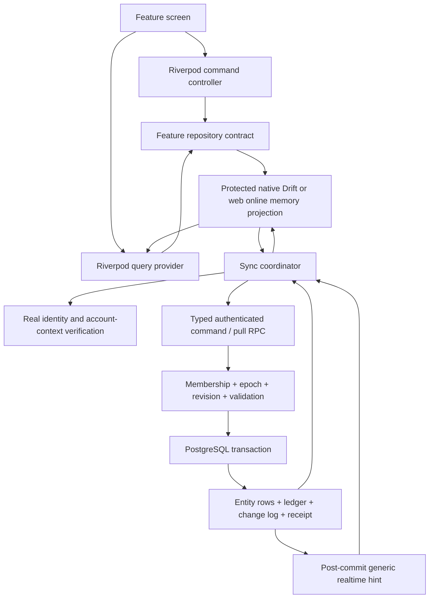
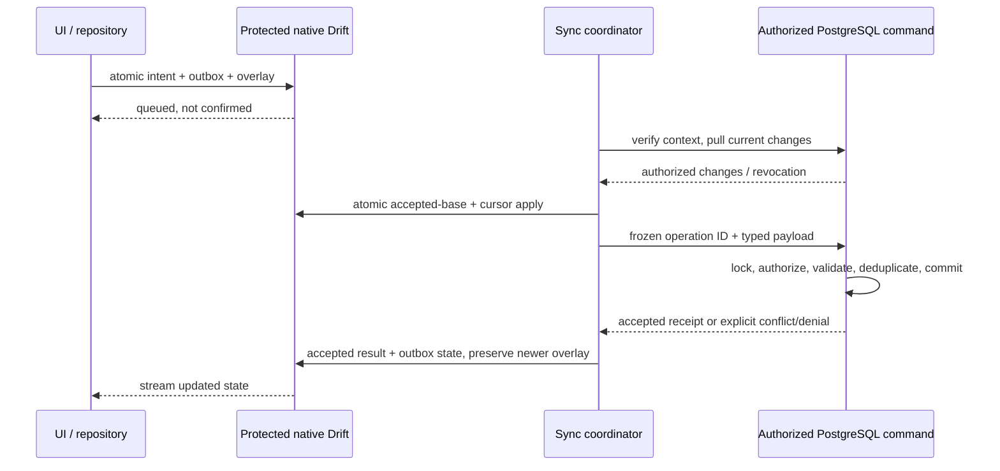

# Application contracts and domain responsibilities

**Current decision specification:** [DECISION_SPECIFICATION.md](DECISION_SPECIFICATION.md) is the reconciled source for wording, status, tests, disclosures and implementation gates. D01/D02/D06/D09 are approved; D03’s recorded revision and unresolved P03/P04/P09 choices are preserved. Other technical directions remain pending formal approval. No backend implementation is authorized.

**Contract sketches, not implementation classes.** Keep the CP-001 Riverpod/GoRouter app and its feature-first boundaries. Introduce only the contracts needed by each approved slice. Avoid a generic `Repository<T>` that bypasses tenant, revision, ledger, or lifecycle rules.

## Domain value/entity specifications

Domain code is pure Dart and does not import Flutter, Drift, Supabase, JSON maps, or Riverpod. Model IDs as validated typed values, not interchangeable arbitrary strings.

| Value/entity | Required semantics |
| --- | --- |
| UserId, CoupleId, MemberId, EntityId, DeviceId, OperationId | UUID validation; never infer authorization from an ID; IDs cannot be silently reused across scopes |
| Revision, SyncCursor, AuthorizationEpoch, PrivacyEpoch | Positive/nonnegative validated BigInt values, canonical decimal-string transport; local DB codec explicitly tested on web/native |
| Money | Currency + immutable exponent + BigInt minor units; parse exact decimal digits, bounds, no implicit FX, float conversion, or mixed-currency addition |
| LocalDate / ZonedWallTime / Instant | Date-only identity distinct from UTC timestamp; explicit IANA zone for wall times/recurrence; deterministic DST policy |
| MembershipContext | Authoritative/leased account status, device status, own current/conditionally eligible archived scopes, membership state/epoch and per-content policy eligibility; no client-set admin/role |
| SharedEntitySnapshot | Typed scope/id/revision, permitted timestamps and pseudonymized attribution when required, tombstone/redaction state; accepted snapshots cannot expose fields removed under D03 |
| LocalEditState | Accepted base, pending overlay, pending operation IDs, last synced time, conflict/rejection state; does not masquerade as accepted domain data |
| SavingsGoal / Contribution | Proposed immutable monetary core, accepted balance/correction history and separate provisional deltas; after account deletion expose only necessary audit fields under P01/P02/P09, not retained free-text notes by default |
| RecurrenceRule / OccurrenceKey | Validated frequency shape; nominal rule-generation/period/anchor identity separate from valid observed date; bounded expansion; revisioned parent aggregate |
| AttachmentIntent / ReadyAttachment | Distinguish local-only bytes, reservation, processing, ready, failure, deletion; ready URL is authenticated ephemeral transport state, not persisted public domain URL |
| CommandResult | accepted(receipt + revisions), queued(operation ID), conflict(safe versions), denied, invalid, retryable, snapshotRequired, unsupportedProtocol |

The UI differentiates `queued` from `accepted`. Typed exceptions/errors use stable safe codes, not raw SQL/PostgREST/Storage errors or intimate diagnostic content. No domain object has an Auth service key, refresh token, invite digest, or notification token field.

## Repository/service surface sketches

Notation below describes signatures to implement later; these are deliberately Markdown, not unused Dart classes.

| Owning module / contract | Proposed operations and responsibilities |
| --- | --- |
| authentication · IdentitySession | `watchSession()`, `signIn(real provider flow)`, `signOut(discardPendingConfirmed)`, `requestAccountDeletion(recentAuth)`, restricted recovery; secure credential storage delegated to platform implementation; no fake user |
| couple_linking · CoupleRepository | `watchContext()`, online `createSpace(command)`, `issueInvite(recipient, operationId)`, `previewInvite(token)`, `acceptInvite(token, operationId)`, `unlink(expectedEpoch, operationId)`; token only transient; server is membership authority |
| bucket_list · BucketRepository | `watchItems(scope, filters)`, `watchCategories(scope)`, `create/edit/setStatus/remove/reorder` typed commands; atomic local enqueue; expected revision; live category checks |
| important_dates · DatesRepository | `watchDates(scope, window)`, `previewOccurrences(rule, window)`, `saveDateAggregate(expectedRootRevision, date, rule, exceptions)`, `removeDate` with bounded expansion and one aggregate conflict boundary |
| savings_tracker · SavingsRepository | `watchGoals(scope)`, `watchLedger(scope, goal)`, `watchBalance(accepted, provisional)`, goal metadata CAS, `recordDeposit`, `reverseDeposit`, `correctDeposit`; immutable typed money/operation IDs, no `setBalance` or `editContribution` |
| plans · PlansRepository | `watchPlans`, `watchTasks`, `watchStops`, typed row edits, dependency-aware child add, revision-checked reorder, aggregate removal |
| memories · MemoriesRepository | `watchMemories`, text edit/remove, `stageLocalAttachment`, online reserve/upload/finalize/remove; never expose Storage credentials to domain |
| dashboard · DashboardQuery | Compose authorized local read projections and personal layout; no duplicate canonical records |
| global_search · SearchRepository | Native protected local search or web session-memory authorized search; no sensitive persistent browser index; purge on revocation/privacy reset; no network endpoint that can search unrelated users |
| settings · PreferencesRepository | Watch/edit own theme, dashboard and notification choices with revisions; server values sync while device OS permission remains local |
| platform integration · DeviceRegistration | Online own-device registration, token rotation/revocation, local notification permission state; no token readable by partner/repository query projections |
| app/core sync · SyncCoordinator | `watchSyncStatus(scope)`, `reconcile()`, `retry(operationId)`, `resolveConflict(newCommand)`, stop/wipe on access change; transport, outbox order and cursors hidden from widgets |
| app/core lifecycle · DataLifecycle | Online authorized export request/status/download, content-scoped privacy removal/redaction and cooperative local cleanup; contracts blocked on P01–P09; no archive-label bypass or remote-erasure promise |

Native repository streams read protected Drift and commands atomically persist intent/outbox/overlay. Initial web repository streams use live-authorized session-memory projections and online commands without sensitive durable storage or outbox. Capability reporting distinguishes durable-native queued, online-web accepted and unsaved memory state. The coordinator is the only writer for native offline-supported commands. Online-only commands explicitly report connectivity requirements and never locally pretend to change membership.

Use a small internal typed `CommandEnvelope` transport with command name/version, operation ID, scope, expected authorization/privacy epochs and revisions, and frozen payload hash. No unrestricted table/column/SQL mutation endpoint. Command handlers must enumerate editable fields and reject unknown protected fields rather than mass-assigning JSON.

## Aggregate and concurrency boundaries

- Date root revision covers recurrence and overrides; any accepted child edit advances root revision. Command validates the entire date aggregate, parent scope, and exception identity.
- Savings deposit/reversal checks current goal open state and immutable currency while holding locks; it does **not** require equality with an old balance-derived goal revision, so independent deposits can commute. It appends ledger + advances goal revision + derives exact balance. Goal metadata/archive commands do require expected goal revision, so they detect intervening ledger/state changes.
- Task/stop edits compare their own row revisions; reorder supplies expected revisions of all touched rows and parent plan revision, then advances both. Dashboard reorder similarly uses preference and widget revisions. Category-list reorder supplies expected **scope head sequence** because there is no category-list entity; this intentionally conflicts with any concurrent shared edit until a dedicated list aggregate is justified.
- Child creation after a live parent succeeds only if the parent is still live under the same scope lock. Parent deletion has precedence over stale child intent.
- Membership and lifecycle commands update shared and personal scope projections atomically. No feature repository is allowed to directly change membership or couple scope on its rows.

## Riverpod composition and routing

Keep `ProviderScope`, `TwogetheraApp`, `appRouterProvider`, existing appearance behavior, and `core/config/app_config.dart`. Later app composition injects database/transport implementations behind domain contracts. Feature providers expose stream queries and typed command controllers. Dispose account/scope-scoped providers and workers on sign-out/revocation; never store cross-account mutable singletons.

When real identity/linking exists, a future session/context provider can notify GoRouter redirects. States must distinguish loading, unauthenticated, unlinked draft, paired, archived read-only, offline lease locked, deleting account, and transient failure. Route guards improve navigation but never grant data access. Do not add these redirects or placeholder login screens during CP-002. A cached session is not proof of current server membership.

The current theme controller remains session-only. A future preferences adapter can hydrate it without rebuilding the router or replacing the existing theme system. Personal theme changes never alter the partner's theme.

## Data flows

The sequence below is native-only; web submits online without a durable outbox.

## Privacy contract gate after D01–D03

Archive queries, ledger projections, exports and erasure commands must carry resolved content eligibility and redaction semantics, not merely CoupleId/member state. Exact retained audit fields/pseudonym mapping, text/photo removal requests, export windows, grace and cleanup timing remain P01–P09 choices. Define those contracts only after their policies are resolved; do not add speculative implementation classes now. No loss of monetary accuracy, stale history re-serving, or claim to recall downloaded data is acceptable as a shortcut.

## Test seams to introduce with implementation

Use deterministic pure-domain tests for exact money/recurrence/command validation; real local Drift migration/transaction/worker tests for persistence; isolated local Supabase/PostgreSQL integration tests for RLS/locking/idempotency; widget tests for pending/conflict/read-only/revocation UX. A fake repository may be a test double only, never the shipped authentication or synchronization implementation. The current six CP-001 tests remain intact and mandatory.

## Reconciled ownership and lifecycle contracts

Queries return content-unit eligibility, permitted projection, deadlines, privacy disposition and both epochs, not just a couple/member flag. Implement distinct `ordinaryDeleteText`, guarded `restoreOrdinaryText` (only after P04 approval), `requestPrivacyRemoval` and archive read/export contracts; do not expose arbitrary restore or erasure authority. Domain ownership/provenance distinguishes origin/contributor aliases, mixed content and protected subjects; it does not claim legal ownership or expose private identity mappings. P03/P04/P09 unresolved policy values block affected contracts.

An archive read stream contains only eligible survivor/separable/redacted content and minimal audit under reviewed deadlines. Account deletion must not automatically empty survivor records. Privacy reset clears affected native accepted/overlay/recovery/media/search state and web memory before new sanitized data appears. Native protected persistence and initial web memory capabilities are explicit repository choices; Riverpod providers/go_router remain unchanged. No future contract classes are added during documentation reconciliation.
