# Relational data model

**Design only.** D01–D11 refer to the [approval register](README.md). PostgreSQL is authoritative for accepted records; Drift mirrors authorized records and stores device-local pending state. No tables are created in CP-002.

## Schema and type conventions

Use an exposed `api` schema for approved read surfaces/command entry points and an unexposed `private` schema for account lifecycle, invitations, devices' secret tokens, receipts, snapshots, and jobs. Tables named below are logical names; migration review must explicitly assign schemas, owners, privileges, RLS, and API exposure. No reliance on implicit `public` grants.

- `uuid` primary keys (`id`) are random v4; clients may allocate entity/operation IDs offline. The server validates ownership, parent scope, and collisions. An ID never conveys permission.
- **M** means standard mutable columns: `created_at timestamptz NOT NULL`, `updated_at timestamptz NOT NULL`, `revision bigint NOT NULL CHECK > 0`. Server sets times and advances revision exactly once per accepted row mutation; insert revision is 1. IDs, scope, creation time, and original authorship are immutable.
- **S** means synchronized shared columns: M plus `couple_id uuid NOT NULL FK couple_spaces(id)`, `created_by_member_id uuid NULL`, `updated_by_member_id uuid NULL`, `deleted_at timestamptz NULL`, `deleted_by_member_id uuid NULL`. Actor IDs reference memberships in the same couple. Server controls actor fields. Soft deletion increments revision; ordinary writes cannot clear a tombstone.
- Every S table has `UNIQUE(couple_id,id)`, a live read index `(couple_id,updated_at,id) WHERE deleted_at IS NULL`, and a tombstone index `(couple_id,deleted_at) WHERE deleted_at IS NOT NULL`. Extra indexes below supplement these. Parent references use composite `(couple_id,parent_id)` FKs to `(couple_id,id)` so cross-couple relations cannot be forged.
- `?` means nullable; other listed fields are required. Required names/titles are trimmed, nonempty and length-bounded; descriptive note/body fields may be empty. Typical title <= 200, note <= 10,000, display name <= 80. All enums/checks are enforced in PostgreSQL, not only Dart.
- Index every FK's referencing columns unless an existing PK/index has that prefix. Scope-first indexes support RLS and queries. Do not create redundant indexes for existing unique constraints. Add query-specific indexes after EXPLAIN, not speculative JSON indexes.
- Cross-row invariants (counts, parent state, matching currency, recurrence bounds against a parent date, reversal validity) require guarded commands plus database triggers/constraints where applicable; they cannot be implemented as row CHECKs that query another row.
- Calendar dates use `date`, instants use `timestamptz` (UTC in transport), and local wall times use `time` plus an IANA zone. Client clocks never choose revision or synchronization order.
- All API bigint amounts, revisions, and cursors serialize as canonical decimal **strings**, avoiding JSON/JavaScript integer rounding. Reject fractional, exponent-form, and out-of-range numeric inputs. Domain arithmetic uses BigInt for money and protocol counters.
- All hard deletion is privileged and ordered, never a client cascade. Parent FKs default to `ON DELETE RESTRICT`. Exceptions are stated below. Tombstones and cleanup ordering are defined in [data lifecycle](DATA_LIFECYCLE.md).

## Identity, membership, and invitations

| Table | Columns beyond its PK / conventions | Constraints and indexes |
| --- | --- | --- |
| `auth.users` | Managed by Supabase Auth; not an application API table | Do not duplicate passwords, refresh tokens, identity credentials, or expose this table |
| `app_users` (private) | `id uuid PK/FK auth.users(id) ON DELETE RESTRICT`, M, `state` active/deleting/disabled, `delete_requested_at?`, `delete_after?` | Checked state/time combinations; no client CRUD; deletion worker must finish cleanup before removing Auth identity; index `(state,delete_after)` |
| `profiles` | `user_id uuid PK/FK app_users(id) ON DELETE CASCADE`, M, `display_name`, `time_zone`, `locale` | Owner-only; no email/phone mirror; validated IANA zone/locale; partner does not get this private row |
| `couple_spaces` | `id`, M, `state` draft/paired/archived/purging, `name`, `time_zone`, `authorization_epoch bigint > 0`, `archived_at?` | Epoch increments on membership/access change; state/count consistency deferred trigger; index `(state,archived_at)`; no reusable archived space |
| `couple_memberships` | `id`, M, `couple_id FK`, `user_id? FK app_users ON DELETE SET NULL`, `seat smallint`, `state` active/archived/revoked, `member_display_name`, `joined_at`, `revoked_at?` | `UNIQUE(couple_id,id)`, `UNIQUE(couple_id,user_id)` for non-null users, `UNIQUE(couple_id,seat)`, `CHECK seat IN (1,2)`, partial `UNIQUE(user_id) WHERE state='active'`; state active/archived requires user not null; index `(user_id,state,couple_id)`; revoked names scrubbed at erasure |
| `partner_invitations` (private) | `id`, M, `couple_id FK`, `inviter_member_id` composite FK, `token_digest bytea`, `recipient_email_hmac bytea`, `hmac_key_version`, `expires_at`, `state` pending/accepted/revoked/expired, `accepted_by_user_id? FK SET NULL`, `accepted_at?` | Unique token digest; partial `UNIQUE(couple_id) WHERE state='pending'`; index `(state,expires_at)`; hash length checks; state metadata consistency; digest never readable via client table access |
| `account_access_events` (private) | `id`, `user_id FK CASCADE`, `scope_id FK sync_scopes`, `authorization_epoch`, `kind` membership_granted/membership_archived/membership_revoked, `created_at` | Own-account sanitized access history; no partner PII; index `(user_id,created_at,id)`; delivered through user sync scope, not exposed as all-user feed |

A draft has exactly one active seat; a paired space exactly two active seats. An archived/purging space has zero active seats and at most one archived reader under D02. At most two memberships **ever** exist per space because seats are not reused, including revoked rows. These are commit-time, server-enforced invariants: deferred constraint triggers on both membership and space transitions, plus the unique constraints. A row CHECK cannot count other rows. Personal-account deletion does not delete shared authorship keys: membership IDs remain pseudonymous until the whole space is purged.

## Bucket lists, dates, savings

All tables in this section use S unless an exception is explicit.

| Table | Entity fields | Constraints and additional indexes |
| --- | --- | --- |
| `bucket_categories` | `name`, `normalized_name`, `color_key`, `sort_key bigint`, `deletion_started_at?` | Unique live `(couple_id,normalized_name)`; accent values from an allowlist; `(couple_id,sort_key,id)` |
| `bucket_items` | `category_id?`, `title`, `description`, `status` planned/done, `target_date?`, `completed_at?`, `sort_key bigint`, `deletion_started_at?` | Composite category FK; done iff completion timestamp present; `(couple_id,status,target_date,id)`; deleting category sets live item category to null in a revisioned command, then tombstones category |
| `important_dates` | `title`, `description`, `start_date date`, `is_all_day bool`, `local_time? time`, `time_zone`, `duration_minutes? int`, `deletion_started_at?` | All-day forbids time/duration; timed requires local time and duration 1..10080; `(couple_id,start_date,id)`; recurrence is optional child row |
| `date_recurrences` | `important_date_id`, `frequency` daily/weekly/monthly/yearly, `interval int`, `weekdays smallint[]?`, `month_day? smallint`, `month? smallint`, `until_date? date`, `occurrence_count? int` | Unique live `(couple_id,important_date_id)`; interval 1..100; weekdays unique 1..7; day 1..31, month 1..12; validate shape by frequency, no simultaneous until/count; until >= start_date; bounded expansion, never infinite persisted rows |
| `date_occurrence_overrides` | `important_date_id`, `original_date date`, `kind` skipped/rescheduled, `replacement_date? date`, `replacement_local_time? time` | Unique live `(couple_id,important_date_id,original_date)`; skip has no replacement; reference recurrence's original occurrence identity; `(couple_id,original_date)` |
| `currencies` (reference, not S) | `code text PK`, `minor_unit_exponent smallint`, `catalog_version` | Approved currency catalog; code 3 uppercase letters, exponent 0..4; unique `(code,minor_unit_exponent)`; read-only authenticated; no client edits |
| `savings_goals` | `title`, `description`, `currency_code`, `minor_unit_exponent`, `target_minor bigint`, `target_date?`, `state` open/archived | Composite currency FK; target 1..9,000,000,000,000 minor units; currency/exponent immutable after creation; `(couple_id,state,target_date,id)`; derived balance is not a user-editable column |
| `savings_contributions` (append-only exception) | `id`, `couple_id`, `goal_id`, `member_id?`, `kind` deposit/reversal, `amount_minor bigint`, `currency_code`, `minor_unit_exponent`, `reverses_id?`, `note`, `occurred_on date`, `recorded_at timestamptz`, `revision=1`, `operation_id uuid` | Unique `(couple_id,id)`, `(couple_id,goal_id,id)`, and `(couple_id,operation_id)`; composite goal FK and currency match goal, enforced in command/trigger; partial unique `(couple_id,reverses_id) WHERE reverses_id IS NOT NULL`; composite self FK includes goal; deposit positive and no reversal reference; reversal negative, exactly negates a deposit from same goal; amount magnitude <= 9e12; index `(couple_id,goal_id,recorded_at,id)` |

### Savings integrity

A contribution is immutable after acceptance, including its note, amount, actor, and effective date. Fix an error with an explicit reversal and a new deposit; one command may append both atomically. The correcting member is recorded independently of the original member. Partial reversals and arbitrary negative adjustments are excluded initially (D05). Both active partners may correct records; the UI must disclose this and show the audit trail. Account erasure may remove personal labels/user mapping but must not rewrite ledger amount/currency/history while retained.

The server locks the scope and goal, derives the actor, validates currency, bounds, state, and idempotency, and computes the resulting balance with exact PostgreSQL `numeric` accumulation of integer values before range-checking 0..9e12. No negative balance or silently rounded result. Ledger sum is the source of truth, not a mutable `saved_amount`. A cached projection is server-derived, versioned, rebuildable, and transactionally checked against the ledger. Target may be exceeded within the balance bound.

Local rows may store each bounded amount as SQLite INTEGER; convert each to BigInt before summation. Do not rely on an unbounded SQLite SUM or Dart web double. JSON amounts and protocol integers are decimal strings. A user-entered decimal amount is parsed as digits at the goal's fixed exponent; extra fractional digits are rejected, not rounded. No float conversion, mixed-currency aggregation, or automatic FX. Financial amounts and notes are excluded from push payloads and analytics.

Goal removal means archive, not ledger deletion; reversal/deposit commands on an archived goal are rejected until a revision-checked reopen while the space remains paired. A whole-space purge may physically remove its ledger according to D03/D04; this is an auditable planner, not an indefinite regulated financial ledger.

## Plans, memories, activity

| Table (S unless stated) | Fields | Constraints / indexes |
| --- | --- | --- |
| `plans` | `title`, `description`, `state` draft/scheduled/completed/cancelled, `starts_at? timestamptz`, `ends_at? timestamptz`, `time_zone`, `deletion_started_at?` | End >= start; scheduled requires start; `(couple_id,starts_at,id)` |
| `plan_tasks` | `plan_id`, `title`, `status` open/done, `assignee_member_id?`, `due_at?`, `sort_key bigint` | Composite plan/member FKs; assignee must be current active member at assignment; `(couple_id,plan_id,sort_key,id)` and `(couple_id,assignee_member_id,status)` |
| `itinerary_stops` | `plan_id`, `title`, `location_label?`, `latitude? numeric(9,6)`, `longitude? numeric(9,6)`, `starts_at?`, `ends_at?`, `sort_key bigint`, `notes` | Latitude -90..90, longitude -180..180, both present or absent; end >= start; `(couple_id,plan_id,sort_key,id)`; ordering ties use ID, not unique fractional float positions |
| `memories` | `title`, `body`, `occurred_on date`, `time_zone`, `plan_id?`, `bucket_item_id?`, `deletion_started_at?` | Composite optional FKs; deleting linked plan/item nulls the link with a new revision, preserves memory; `(couple_id,occurred_on DESC,id)` |
| `photo_attachments` | `memory_id`, `uploader_member_id`, `state` reserved/processing/ready/failed, `upload_path`, `object_path?`, `media_type?`, `byte_size? bigint`, `sha256? bytea`, `width? int`, `height? int`, `caption`, `sort_key bigint`, `reservation_expires_at` | Composite memory/uploader FKs; globally unique upload_path and non-null object_path; raw/clean keys contain server-reserved UUIDs; limit source to 10 MiB and decoded 40 MP, JPEG/PNG/WebP; ready requires validated metadata and clean object path; `(couple_id,memory_id,sort_key,id)`; expiration index for cleanup |
| `activity_events` (append-only) | `id`, `couple_id`, `actor_member_id?`, `kind`, `entity_type`, `entity_id`, `entity_revision bigint`, `operation_id`, `created_at`, `revision=1` | Unique `(couple_id,operation_id,entity_type,entity_id,entity_revision)`; `(couple_id,created_at DESC,id)`; kind/type allowlists; reference is a validated typed logical target, not a general FK; no embedded deleted text, invitation tokens, email, balances, or photo URLs |

For bounded interactive removals, deleting a plan/date/memory explicitly tombstones all dependent tasks/stops/recurrences/overrides/attachments in the same scope transaction, emitting a deletion event per row. It also clears nullable cross-feature links with new revisions. A stale child insert after deletion is rejected. Hard FK cascades must not substitute for synchronization-visible tombstones. For oversized removals, first set the root deletion_started_at, increment revision, and emit a change: readers hide the root and owning children, and commands reject new edits/children. A bounded worker emits child tombstones/link cleanup and finally the root tombstone. Snapshots exclude roots/children pending deletion. This column is server-managed and cannot be cleared by clients. Activity is not the security audit log or durable synchronization log; it may be pruned independently.

## Preferences, devices, and operational metadata

| Table | Fields / keys | Constraints and indexes |
| --- | --- | --- |
| `notification_preferences` | `user_id PK/FK CASCADE`, M, `enabled bool`, `quiet_start? time`, `quiet_end? time`, `time_zone`, `hide_content bool` | Owner-only; quiet times both set or both absent; defaults hide content; preferences are independent of OS permission |
| `notification_type_preferences` | `(user_id,type) PK`, FK user CASCADE, M, `enabled`, `lead_minutes int` | Type allowlist, lead 0..525600; owner-only; missing rows inherit documented defaults |
| `theme_preferences` | `user_id PK/FK CASCADE`, M, `mode` system/light/dark, `accent_key` | Owner-only; allowlisted theme choices; no couple-wide forced theme |
| `dashboard_preferences` | `id`, M, `user_id FK CASCADE`, `couple_id` composite membership entitlement validated, `layout_version int` | Unique `(user_id,couple_id)`; unauthorized/erased scope rejected; index `(couple_id,user_id)` |
| `dashboard_widgets` | `(preference_id,widget_key) PK`, FK dashboard preference CASCADE, M, `visible bool`, `sort_key bigint` | Widget allowlist; one preference's widget sequence updates atomically, no cross-user reads |
| `devices` (private) | `id`, M, `user_id FK CASCADE`, `installation_id uuid`, `platform`, `label`, `last_seen_at`, `revoked_at?` | Unique `(user_id,installation_id)`; platform enum; index `(user_id,revoked_at)`; installation IDs are not authentication credentials |
| `notification_tokens` (private) | `id`, M, `device_id FK CASCADE`, `provider`, `token_ciphertext`, `token_digest`, `disabled_at?`, `last_success_at?` | Unique live `(provider,token_digest)`; registration via authenticated online command, no client SELECT; previous account's binding disabled on authenticated device account switch |
| `sync_scopes` (private) | `id`, `kind` user/couple, `user_id? FK CASCADE`, `couple_id? FK RESTRICT`, `last_sequence bigint >= 0`, `retention_floor bigint >= 0`, `updated_at` | Exactly one subject matching kind; partial unique user_id / couple_id; floor <= last_sequence; one counter row lock serializes each scope's accepted transactions |
| `sync_changes` (private) | `(scope_id,sequence) PK`, scope FK, `entity_type`, `entity_id`, `entity_revision`, `kind` upsert/delete, `after_image? jsonb`, `recorded_at` | Sequence > 0; deletion has minimal ID/revision/time and no body; index `(scope_id,recorded_at,sequence)`; bounded, allowlisted sanitized after-images; accessed only via authorized pull RPC |
| `operation_receipts` (private) | `(actor_user_id,operation_id) PK`, user FK CASCADE, `scope_id FK`, `device_id? FK SET NULL`, `command_type`, `request_hash`, `result_code`, `result_entity_ids`, `result_revisions`, `committed_at` | Success receipt and all mutations commit together; no raw request body/tokens; retry with different hash rejected; index `(scope_id,committed_at)`; retained through scope lifetime, not just log retention |
| `device_scope_cursors` (private) | `(device_id,scope_id) PK`, FKs, `authorization_epoch`, `ack_sequence`, `last_seen_at`, `snapshot_required bool` | ACK bounded by current scope head and a previously delivered server-authenticated page token; authorization checked before use; hint for cleanup/diagnostics, not proof of membership |
| `sync_snapshots` (private) | `id`, `scope_id FK`, `requester_user_id FK CASCADE`, `device_id FK`, `authorization_epoch`, `high_water_sequence`, `created_at`, `expires_at` | Snapshot bound to requester/device/epoch; expire after 15 minutes; bounded size; `(expires_at)` cleanup index |
| `sync_snapshot_chunks` (private) | `(snapshot_id,ordinal) PK`, snapshot FK CASCADE, `payload jsonb`, `checksum` | Immutable sanitized rows; ordered page chunks materialized atomically with snapshot header; no direct client table reads |
| `security_audit_events` (private) | `id`, `actor_user_id? FK SET NULL`, `couple_id? FK SET NULL`, `action`, `outcome`, `request_id`, `created_at` | Append-only service log; no invite secrets, content, token plaintext, or email; `(couple_id,created_at)` / `(created_at)`; retention proposal 90 days |
| `lifecycle_jobs` (private) | `id`, `user_id? FK SET NULL`, `couple_id? FK SET NULL`, `kind` erase_account/purge_space/remove_media/expire_upload/expire_export, `state` queued/running/retry/completed/failed, `idempotency_key`, `run_after`, `attempts`, `lease_owner? uuid`, `lease_expires_at?`, `last_error_code?`, `progress jsonb`, `created_at`, `updated_at` | Unique idempotency_key; exactly one applicable subject per kind; due-work index `(state,run_after)`; bounded diagnostics; claim/lease/retry protocol |
| `export_jobs` (private) | `id`, `requester_user_id FK CASCADE`, `couple_id? FK`, `state` queued/running/ready/failed/cancelled/expired, `authorization_epoch?`, `snapshot_sequence?`, `object_path?`, `expires_at`, `created_at` | Owner request/status via RPC; scope access checked both generation and download; `(requester_user_id,created_at)`, `(expires_at)` |

Mutable application rows use M revisions; append-only rows stay at revision 1 or use their stream sequence. Operational counters, cursors, snapshot chunks and leased jobs use their explicit counter/epoch/lease predicates and locked updates instead of an unrelated application entity revision.

No general public notification-inbox table is assumed. Scheduled reminders are derived from dates/plans plus the owner's preferences; a later notification implementation must add an idempotent delivery log and approved retention, rather than using `activity_events` as a delivery queue. Search and calendar are authorized projections of core records, not duplicate canonical entities. No raw notification tokens, auth identities, or invite digests appear in Drift.

## Entity relationship overview

The diagram omits common timestamps and operational child fields; the tables above are normative.

```mermaid
erDiagram
    AUTH_USERS ||--|| APP_USERS : identity
    APP_USERS ||--o| PROFILES : owns
    APP_USERS o|--o{ COUPLE_MEMBERSHIPS : participates
    COUPLE_SPACES ||--|{ COUPLE_MEMBERSHIPS : seats
    COUPLE_SPACES ||--o{ PARTNER_INVITATIONS : invites
    COUPLE_MEMBERSHIPS ||--o{ PARTNER_INVITATIONS : creates
    COUPLE_SPACES ||--o{ BUCKET_CATEGORIES : categorizes
    BUCKET_CATEGORIES o|--o{ BUCKET_ITEMS : organizes
    COUPLE_SPACES ||--o{ BUCKET_ITEMS : owns
    COUPLE_SPACES ||--o{ IMPORTANT_DATES : owns
    IMPORTANT_DATES ||--o| DATE_RECURRENCES : repeats
    IMPORTANT_DATES ||--o{ DATE_OCCURRENCE_OVERRIDES : exceptions
    COUPLE_SPACES ||--o{ SAVINGS_GOALS : owns
    CURRENCIES ||--o{ SAVINGS_GOALS : denominates
    SAVINGS_GOALS ||--o{ SAVINGS_CONTRIBUTIONS : records
    SAVINGS_CONTRIBUTIONS o|--o| SAVINGS_CONTRIBUTIONS : reverses
    COUPLE_SPACES ||--o{ PLANS : owns
    PLANS ||--o{ PLAN_TASKS : contains
    PLANS ||--o{ ITINERARY_STOPS : orders
    COUPLE_SPACES ||--o{ MEMORIES : owns
    MEMORIES ||--o{ PHOTO_ATTACHMENTS : attaches
    COUPLE_SPACES ||--o{ ACTIVITY_EVENTS : records
    APP_USERS ||--o| NOTIFICATION_PREFERENCES : configures
    APP_USERS ||--o{ NOTIFICATION_TYPE_PREFERENCES : configures
    APP_USERS ||--o| THEME_PREFERENCES : chooses
    APP_USERS ||--o{ DASHBOARD_PREFERENCES : customizes
    COUPLE_SPACES ||--o{ DASHBOARD_PREFERENCES : context
    DASHBOARD_PREFERENCES ||--o{ DASHBOARD_WIDGETS : arranges
    APP_USERS ||--o{ DEVICES : registers
    DEVICES ||--o{ NOTIFICATION_TOKENS : receives
    APP_USERS o|--o| SYNC_SCOPES : personal_scope
    COUPLE_SPACES o|--o| SYNC_SCOPES : shared_scope
    SYNC_SCOPES ||--o{ SYNC_CHANGES : orders
    SYNC_SCOPES ||--o{ OPERATION_RECEIPTS : deduplicates
    DEVICES ||--o{ DEVICE_SCOPE_CURSORS : acknowledges
    SYNC_SCOPES ||--o{ DEVICE_SCOPE_CURSORS : tracks
    SYNC_SCOPES ||--o{ SYNC_SNAPSHOTS : snapshots
    SYNC_SNAPSHOTS ||--o{ SYNC_SNAPSHOT_CHUNKS : pages
    APP_USERS ||--o{ ACCOUNT_ACCESS_EVENTS : learns
    APP_USERS ||--o{ EXPORT_JOBS : requests
```

