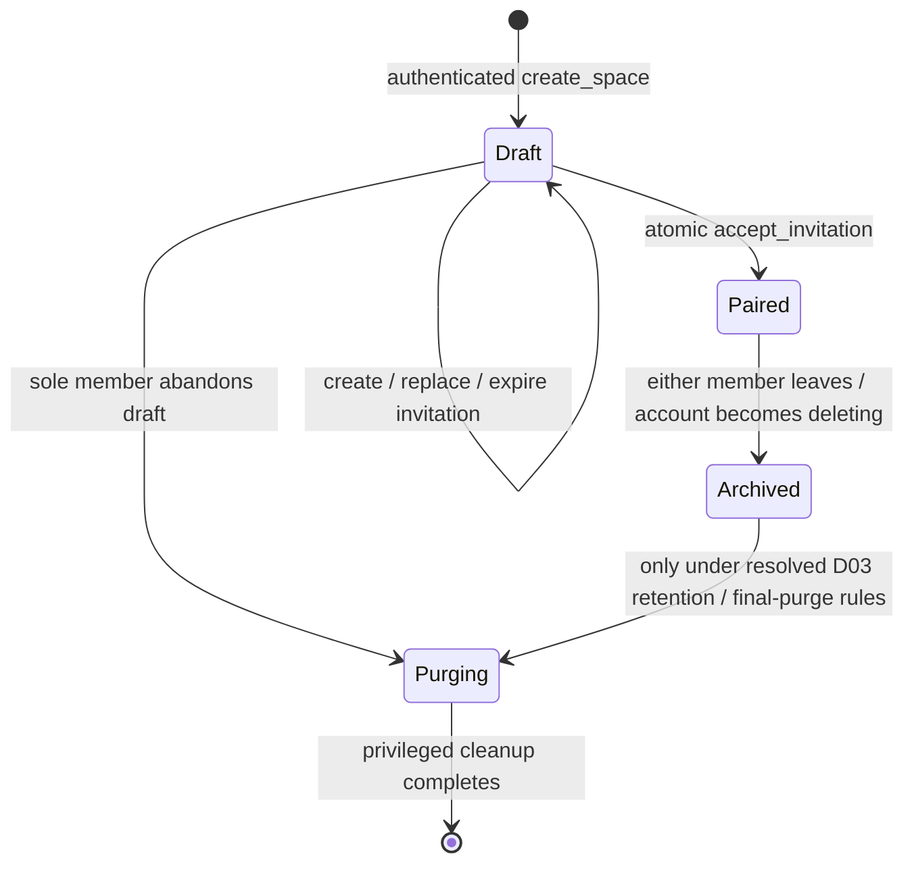
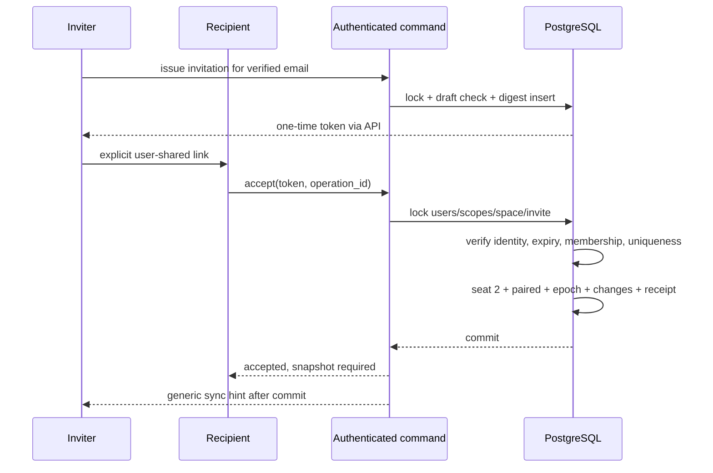

# Partner linking protocol

**Current decision specification:** [DECISION_SPECIFICATION.md](DECISION_SPECIFICATION.md) is the reconciled source for wording, status, tests, disclosures and implementation gates. D01/D02/D06/D09 are approved; D03’s recorded revision and unresolved P03/P04/P09 choices are preserved. Other technical directions remain pending formal approval. No backend implementation is authorized.

**Design only.** D01, D02, D06 and D09 are approved. D10 remains technically endorsed pending formal approval; it must not be treated as approved by this design. No invite endpoints, email sender or authentication screen exists yet.

## Approved boundaries and proposed states

D01 and D09 are formally approved: one active couple space per account, no more than two active members, no archive reuse/replacement partner, setup/invitation access while unpaired but no shared planner content, shared planner writes only while exactly two members are actively linked, and archive operations restricted to read/export/privacy removal. A new space may be represented as a one-member draft and becomes paired only after a second distinct member accepts; this is an implementation encoding of the approved access boundary, not approval of extra draft privileges. Archived content eligibility remains conditional under D02/D03 and unresolved P03/P04/P09. The creator has no permanent unilateral admin privilege over the other partner.

D06 is formally approved: a verified-recipient email binding, single-use 256-bit token, 24-hour expiry, atomic acceptance, safe/idempotent duplicate and replay handling, and abuse limits on creation and acceptance. Numeric limit thresholds, Auth email canonicalization/change behavior and HMAC/key rotation are implementation/security details to specify and test; no automatic delivery is approved.

At commit: draft => 1 active, paired => 2 active, archived/purging => 0 active; archived => at most 1 archived reader, all other seats revoked. Unique seat checks and partial unique active user index are necessary but not sufficient: deferred constraints validate space/member counts and legal transitions. No client INSERT/UPDATE/DELETE grants on either table.

## Create and issue

1. User must be authenticated with a verified server-side email identity and active account. `create_space(operation_id, name, time_zone)` checks idempotency and current membership, creates the space/member/sync scope atomically, and returns only its authorized projection.
2. Creator explicitly enters the recipient's email. Server normalizes according to its verified-identity policy (trim surrounding whitespace, canonical domain, do not invent Gmail-style dot/plus equivalence) and stores a keyed HMAC with key version; plaintext is not stored in the invitation or activity. Future key management is server-only and requires no key now; retain verification keys through invite expiry or explicitly revoke affected invites on key retirement.
3. `issue_invitation` locks the creator/account and scope, confirms draft and sole membership, revokes an existing pending invite, and creates a cryptographically random 256-bit token. Store only SHA-256 token digest and recipient HMAC. Expiry is server UTC now + 24 hours. Partial unique pending invitation enforces one outstanding invite; an expired pending row is explicitly transitioned before creating another, not indexed using volatile `now()` predicates.
4. Return the token/link once to its authenticated creator. The app offers user-initiated sharing; do not silently send messages. Reopening the app cannot recover the token from the database; regenerate if lost. Do not persist the token to Drift, analytics, clipboard history owned by the app, crash logs, or saved URLs.
5. Invite links should carry the token in a fragment handled by the client and immediately removed from visible history after capture. No third-party scripts/trackers on the landing page, restrictive referrer policy, no tokens in HTTP query/access logs. The token is submitted over TLS in an authenticated request body and cleared after use/cancel. For the existing hash-router foundation, a future web link can use `/#/join?token=...` (token is inside the fragment, not the HTTP query), then replace history with `/#/join` after capture. This route is not added in CP-002. If external Auth navigation would lose in-memory state, ask the user to sign in and reopen the original invitation; do not persist the token or place it in an OAuth redirect/state parameter. Native deep-link handling must apply the same redaction. A manually shared link remains sensitive even when email-bound.

Do not disclose whether the recipient already has an account. The inviter sees a masked recipient summary and expiry through an authorized RPC, never arbitrary identity lookup or stored digests.

## Acceptance and concurrency algorithm

Acceptance is **online only** and explicitly confirmed by the recipient after signing in. A pre-auth landing page is generic. A verified email match permits a minimal authenticated preview, but does not grant couple data access or planner records while unpaired. A wrong email, unknown token, expired/revoked token, and inaccessible invite return a generic unavailable result. Enforce measured server-side abuse limits on both issue and acceptance attempts; audit sanitized outcomes without raw secrets.

Commands that mutate user/membership/scope state use this lock order: relevant `app_users` rows sorted by UUID; relevant `sync_scopes` sorted by UUID; couple rows sorted by UUID; then invitation/entity rows sorted by ID. Ordinary shared writes follow the same order for their actor and shared scope. Discover lock targets before acquiring locks, then re-read and validate; if membership/scope discovery changed, release/retry the transaction instead of acquiring an out-of-order lock. Creation of a previously absent personal scope is serialized by its app_user lock. Deadlock/serialization failures retry with the same operation ID.

Before resolving a token or applying fresh-invite state checks, an authenticated retry may find an already committed `(actor,operation_id)` receipt. Validate the identical request hash and current account/scope access before returning its sanitized result. This works even if the invite has since expired or its digest was pruned; own operation-status lookup uses the non-secret operation ID. A pending network request may persist that ID locally, but never the raw token. If no receipt exists, proceed with the fresh transaction below; recheck the receipt under locks for concurrent duplicates.

Acceptance transaction specification:

1. Resolve token digest internally without exposing invite details. Identify inviter, recipient, couple, and both personal scopes. Acquire locks in the canonical order, including both app_user rows and shared/personal scope counters. Lock invite; reread all state after locks. Before any fresh-invite validation, recheck the actor/operation receipt: identical already-committed request returns its sanitized result only after current access verification; a different request hash is rejected.
2. For a fresh operation (after the receipt check), derive recipient from `auth.uid()`, confirm active account and current verified Auth email matches stored recipient binding. Reject self-acceptance, unverified email, expired invite using server time, non-pending state, non-draft space, absent/revoked inviter, or a space that is not eligible to pair. Recipient cannot be a different historical member of that space.
3. Check the recipient has no active membership. Do not auto-leave or merge another couple, including a single-member draft. Require an explicit separate abandon/unlink workflow first. An unpaired space exposes setup/invitation only, never planner content, under approved D09.
4. For this new operation, validate protocol/command shape and freeze its canonical request hash. A consumed token with a different operation ID is unavailable; no alternate seat or second space is created. The earlier receipt check is the sole idempotent exception to that single-use response. Unique receipt/seat/member constraints remain the final commit-time backstop.
5. Insert seat 2 with the authenticated user. Set space to paired, increment authorization_epoch and relevant row revisions; mark invite accepted with recipient and timestamp. Revoke any other pending invites defensively. Append shared sanitized membership/space changes and both users' access events. Assign per-scope sequences under locked counters, and write success receipt in this same transaction.
6. Deferred state/count/uniqueness checks must pass at commit. Only after commit return success and trigger generic invalidations. The recipient's first data load is an authorized snapshot; do not copy an old unrelated scope cache.

With two accept requests, only one can consume the pending invite and seat; the other sees accepted state after waiting. With two invitations to different spaces accepted by the same account, the recipient app_user lock and partial unique active membership ensure only one can succeed. Invite expiry/revocation/unlink races serialize under the same locks and rechecks. `COUNT(*) < 2` without a lock and unique constraints is **not** sufficient. An UPDATE that changes pending to accepted without membership insertion in the same transaction is forbidden.

[PostgreSQL row-level locks](https://www.postgresql.org/docs/current/explicit-locking.html) provide the serialization primitive; this particular transaction and its invariants are proposed application behavior and need integration testing.

## Leaving, deletion, and recovery

D02 approves either partner leaving independently, with immediate loss of former-scope server access for the departing partner. The proposed online transaction locks/revokes the leaver, stops future former-scope reads/writes/media/exports, invalidates epoch/invites and emits safe access changes. The remaining partner may receive a read-only archive only under resolved D03 eligibility/retention rules; changing a membership state to archived is not permission to retain/read all content. Revised P03/P04/P09 block final archive grants; technically endorsed P05 still needs verified safeguards. Preserve eligible separable survivor content; account deletion is not blanket destruction of all nonfinancial records. Stale offline writes must fail rather than move into a new couple. Any export opportunity depends on P06 and cannot delay safe exit. Already downloaded/in-flight bytes cannot be reliably recalled; cooperative cache cleanup is not remote erasure.

Technically endorsed P07/D10 provide immediate account denial and 30-day private-only recovery pending formal approval; cancellation never restores membership/archive or resets shared clocks. Revised P03 classification and P09 necessity/horizon remain unresolved. Apply account-state checks independently of old JWT validity; no backend saga is implemented. D01 forbids archived-space reuse with a replacement partner, and a new partner receives no historical access. Archive deletion/last-reader departure does not silently determine the audit-history purge policy. See [data lifecycle](DATA_LIFECYCLE.md) for the required removal/retention/export process and open gates.

Lost-invite recovery is regenerate/revoke, not recover stored plaintext. Account recovery uses real Auth identity verification and must not grant partner access by answering relationship questions. An accept/create/unlink network timeout is resolved by operation status/current account context; never infer success from a local UI state.
