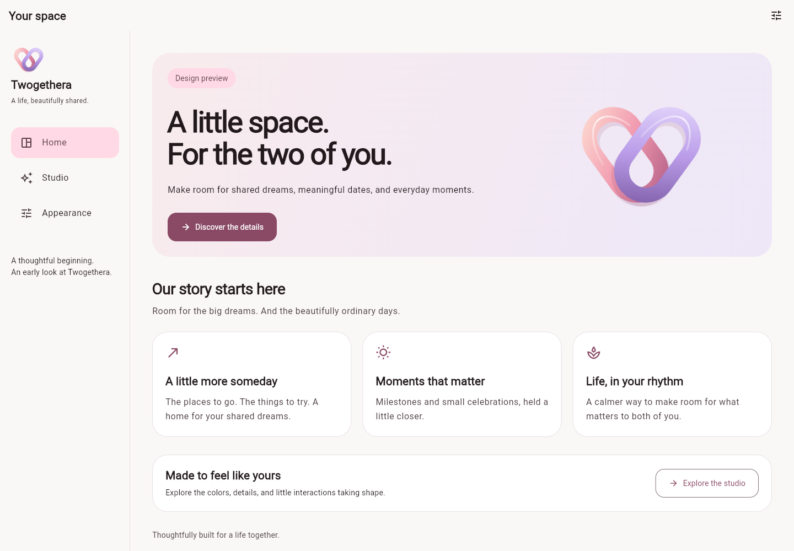
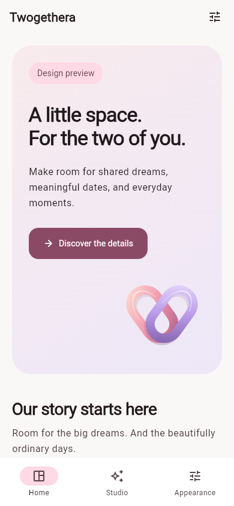
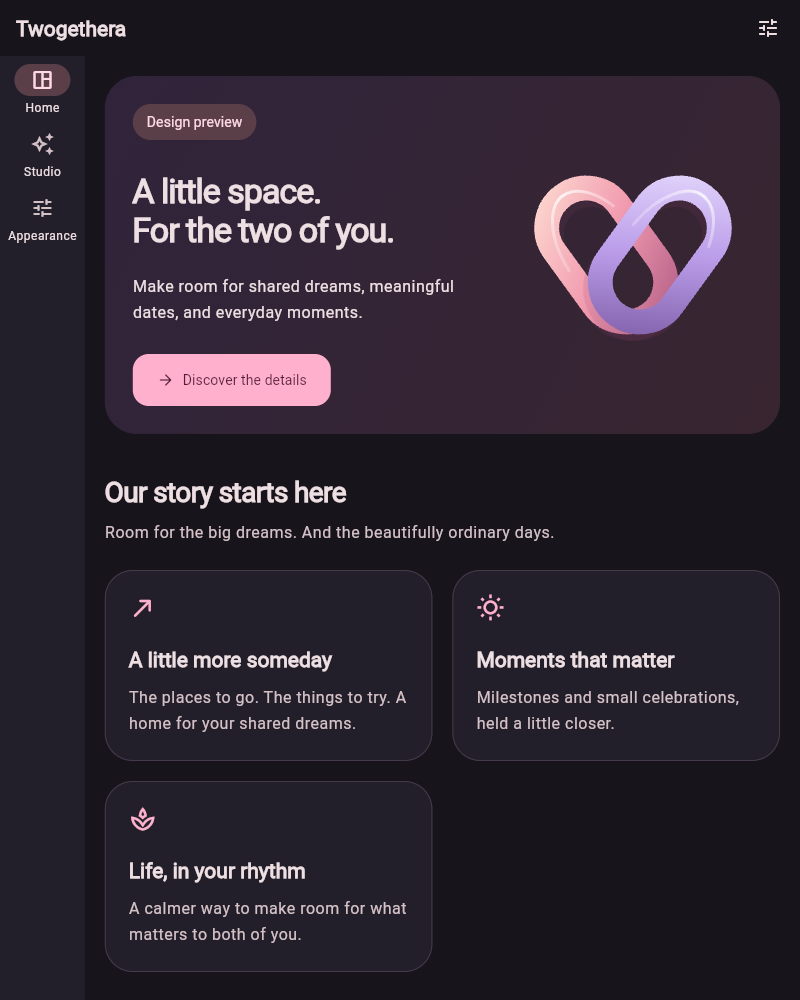
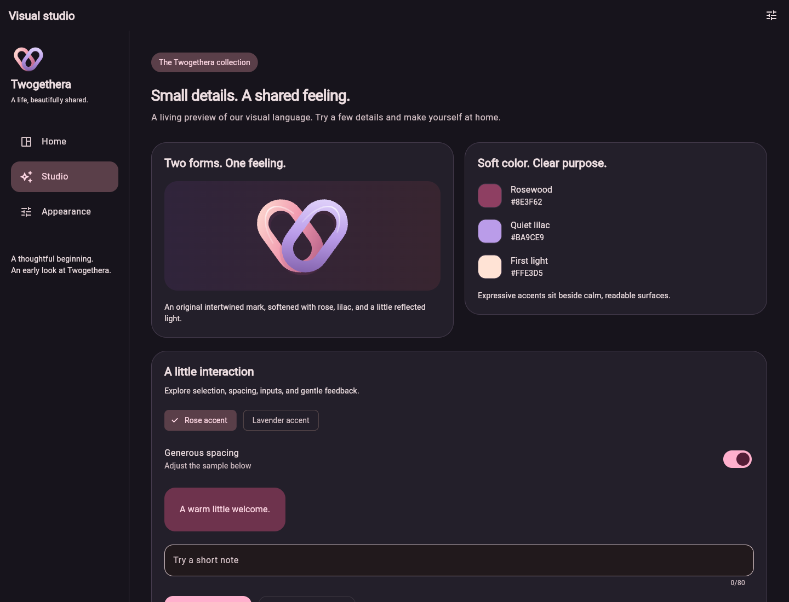
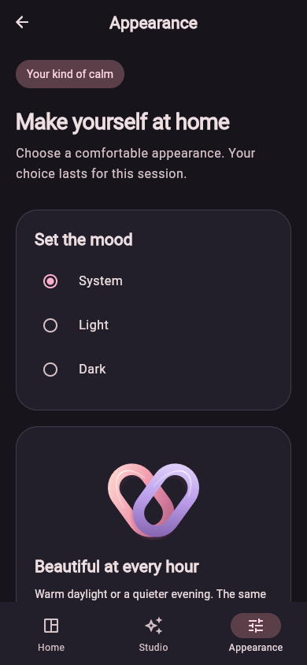

# CP-003A preview gallery

Actual Flutter renders captured in Chrome, not static mockups. The home cards describe the future product; Studio controls demonstrate ephemeral UI only. All product decisions D01–D11 remain pending.

## Desktop · light · 1440 × 1000

## Phone · light · 390 × 844

## Tablet · dark · 800 × 1000

## Studio · dark · 1440 × 1100

## Appearance · dark · 390 × 844

These captures show the initial viewport; each page scrolls to additional content. The live app supports actual width changes, session theme selection, navigation, and Studio controls. See [visual system](VISUAL_SYSTEM.md) and [implementation report](../CP-003A.md).
